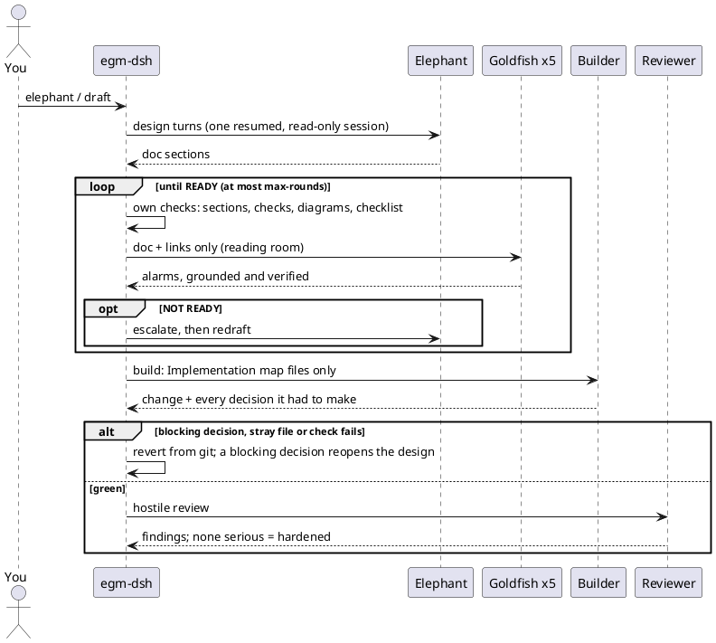
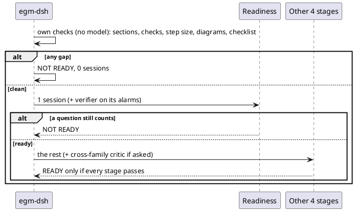
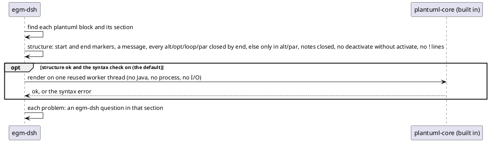
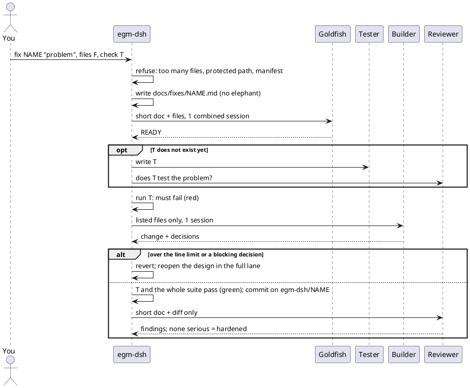
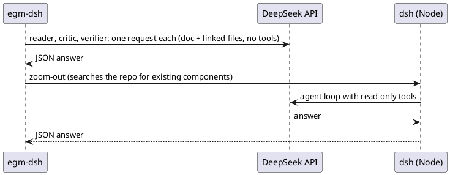
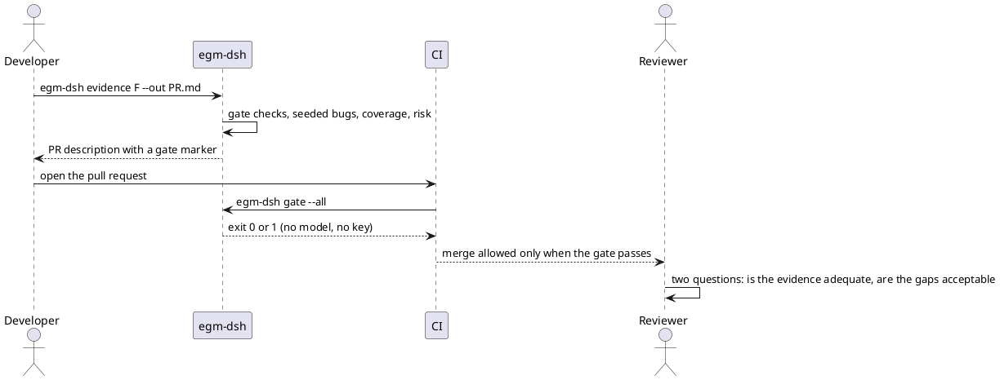
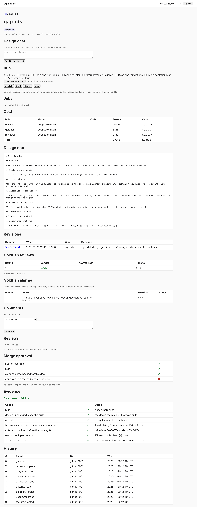
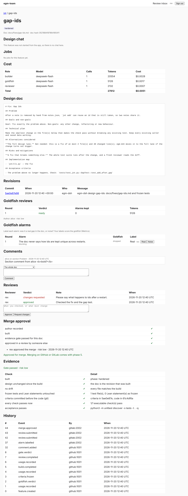
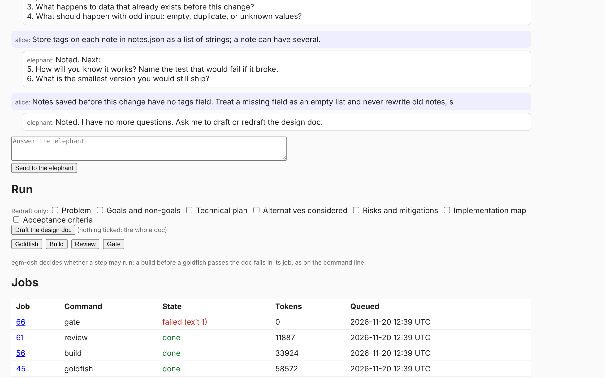

# egm-dsh — Elephants, Goldfish and DeepSeek Harness

`egm-dsh` is a command-line workflow for the Elephant-Goldfish Model from Dave Rensin's essay *Elephants, Goldfish and the New Golden Age of Software Engineering*, with [DeepSeek Harness](https://github.com/deepseek-ai/deepseek-harness) (`dsh`) as the coding agent.

It is an independent project. Google publishes its own [Elephant-Goldfish Model plugin](https://github.com/google/elephant-goldfish-model), installed as `egm`; this CLI is named `egm-dsh` and keeps its state in `.egm-dsh/` so the two never collide. egm-dsh's goldfish run as Google's reviewer personas, vendored under Apache-2.0 (see [Upstream personas](#upstream-personas-and-standards)).

- **Elephant** — a long design conversation that remembers everything. egm-dsh runs it as one DeepSeek Harness session in **read-only** mode, so the agent can read your repository but cannot write a line of code. It interrogates you, then writes the design doc one section at a time.
- **Goldfish** — five brand-new sessions with no memory. Each reads only the design doc and the files it links, then explains it back (Naive Reader), criticizes it (Design Critic), zooms out to check simplicity and reuse (Skeptical Architect), says whether it could build it (Tech Lead), and restates the acceptance criteria as checkable predicates. If a goldfish is confused, the doc is missing context.
- **Gate** — `egm-dsh build` is refused until a goldfish passes the *current* revision of the doc. Editing the doc reopens the design. The gate is proved in Lean 4 and re-checked by a bounded model check in the Rust tests.

- **Small steps** — egm-dsh works per feature: one small design doc, one gate, one build. You get iterative, spec-driven development by cutting the work into a chain of small features, not by writing one big spec. Steps can depend on each other, build in phases, and hand shared files from one step to the next.

- **Executable spec** — with `--tests-first`, a fresh session writes the acceptance tests before any code. Each test must fail first (red); a goldfish confirms it tests its criterion; egm-dsh freezes it; and the build must turn it green without touching it. A doc's `## Examples` are run as tests, and `Check: lean file#theorem` criteria must be proved.

- **Safe to pilot** — model-written tests, examples and acceptance runs execute in a scratch copy under bubblewrap (read-only root, no network, no secrets). Builds work on a branch per feature, commit accepted phases, and revert rejected ones exactly; merges are yours. `egm-dsh doctor` checks all of it.

- **Tunable reviewers (proof of concept)** — [Harness²](https://github.com/google-research/harness2) can tune the goldfish reviewers' prompt text offline. egm-dsh adopts a tuned setup only if it beats the base on held-out labelled docs, costs at most 1.25x the input tokens, and you approve it. The setup can never reach the verdict rules.

- **Right-sized models** — every role runs on its own model, reasoning effort and tool list. The default `balanced` preset gives the elephant and the builder DeepSeek V4 Pro and gives the goldfish and the reviewer Flash. `egm-dsh usage` shows what each role cost.

- **A team web app** — `egm-team` lets developers, reviewers and approvers follow every feature in the browser: the board, the design doc and its revisions, goldfish reviews, evidence, metrics and the audit trail. People sign in with GitHub or GitLab, every page checks a Lean-proven policy first, and every change is recorded in [Vesdb](https://github.com/dhaneshkk/test1_vesdb), a tamper-evident audit log. Reviewers comment, label goldfish alarms real or noise (which scores the goldfish by MCC), review and approve merges from a risk-sorted inbox; nobody approves their own work, and a high-risk merge needs the approver. Developers run egm-dsh from the browser too: start a feature, answer the elephant in a chat, then draft, goldfish, build, review and gate, each a job a worker runs one at a time per project, with its log streamed, its tokens and cost counted, and a monthly token ceiling.

**New here?** The [user guide](docs/USER_GUIDE.md) walks through each role step by step: developers on the command line, teammates in the web app, the admin who runs it, and the auditor who checks the record. This README explains how it all works.

### What is in this repository

| Path | What it is | Build |
|---|---|---|
| `src/main.rs` | `egm-dsh`, the command line | `cargo install --path .` (Rust 1.97+) |
| `crates/egm-core` | Everything egm-dsh does, as a library; the access policy | library |
| `crates/egm-audit` | `egm-audit`: events into Vesdb, replay, receipts and bundles | `cargo install --path crates/egm-audit` |
| `crates/egm-web` | `egm-team`, the team web app (Topcoat, Postgres) | `cargo install --path crates/egm-web` (Rust 1.99+) |
| `proofs/` | Lean 4 proofs of the gate, the policy, replay and the audit link | `lean proofs/<file>.lean` |
| `tests/e2e/` | End-to-end suites on the real dsh binary with a scripted model | see [Guarantees](#guarantees-and-how-they-are-checked) |
| `docs/USER_GUIDE.md` | The user guide | — |

### The whole flow



## Quick start

```sh
cargo install --path .        # or: cargo build --release
egm-dsh demo                      # offline: the whole loop on a bundled sample, in seconds
```

`cargo build --workspace --release` builds every binary (`egm-dsh`, `egm-audit`, `egm-team`). For the team web app, see [egm-team](#egm-team-the-team-web-app) and the [user guide's admin part](docs/USER_GUIDE.md#part-3-running-egm-team).

`egm-dsh demo` creates `./egm-dsh-demo`, a tiny Python note-taking CLI called `jot`, and adds a feature to it: *tag notes and list notes by tag*. The first goldfish review fails because the design never says what happens to notes saved before tags existed; you answer, the elephant redrafts, a fresh goldfish passes, and only then does the agent build. Run the same script against real DeepSeek Harness with:

```sh
export DEEPSEEK_API_KEY=sk-...
egm-dsh demo --dir jot-real --agent dsh                   # --preset economy for the cheapest run
```

## Using it on your own project

```sh
cd my-project
egm-dsh init --agent dsh --acceptance cargo test          # or pytest, npm test, ...
egm-dsh elephant rate-limit --idea "Limit each API key to 100 requests a minute"
egm-dsh elephant rate-limit --say "Keys are per customer; bursts up to 20 are fine"
egm-dsh draft rate-limit                                  # the whole doc in one elephant turn: Problem … Acceptance criteria
egm-dsh goldfish rate-limit                               # not ready? turn its questions into decisions:
egm-dsh escalate rate-limit                               #   the elephant answers what the repo settles, escalates the rest
egm-dsh decide rate-limit 2 B                             #   pick a labelled option (or --other "your answer")
egm-dsh redraft rate-limit                                #   decisions go into the doc; back in design
egm-dsh goldfish rate-limit                               # a fresh goldfish must pass the new revision
egm-dsh build rate-limit                                  # only after a goldfish passes this exact doc
egm-dsh review rate-limit                                 # a fresh, deliberately hostile review
egm-dsh drift                                             # exit 2 if code and docs disagree
egm-dsh status
```

Already have a design doc, for example one written by Google's `egm-draft` skill? Put it under the gate instead of starting an elephant session:

```sh
egm-dsh adopt rate-limit --doc docs/designs/rate-limit.md  # reads upstream headings (The Problem, Goals/Non-Goals, Detailed Implementation Plan, ...)
egm-dsh goldfish rate-limit                                # sections it lacks (often Acceptance criteria) come back as questions
```

| Command | Agent access | What happens |
|---|---|---|
| `elephant <f> --idea/--say` | read-only, resumed session | design conversation; creates `docs/designs/<f>.md` |
| `draft <f> [--section S]… [--per-section] [--max-words N]` | read-only, same session | the elephant writes the doc in one turn (sections it leaves out are drafted one by one); `--section` is repeatable, several go in one turn; egm saves them |
| `adopt <f> --doc PATH` | none | register an existing doc; the gate starts at `designing` |
| `goldfish <f> [--cross-family] [--fail-fast]` | read-only, 5 fresh sessions | comprehension, critic, zoom-out, readiness, invariants → verdict; `--fail-fast`: egm-dsh's own checks, then readiness alone, then the rest |
| `escalate <f>` | read-only, elephant session | after NOT READY: each open question is answered from the repository (egm-dsh checks the cited file and quote) or becomes a decision with labelled options |
| `decide <f> [# KEY \| # --other TEXT]` | none | list the decisions, or record a choice |
| `loop <f> [--max-rounds 5] [--stall 2] [--full]` | read-only sessions | fail-fast goldfish → escalate → redraft rounds; redrafts on its own only when the repository answered everything; stops for decisions, stalls, budgets, READY; never builds |
| `fix <f> "problem" --files F --check TEST \| --manual HOW` | one goldfish, (tester), one builder, one diff reviewer | a tiny fix: short doc, red, build, green, diff review; too big → reverted and moved to the full lane; `fix <f>` alone continues |
| `set-diagrams prefer\|require\|off [--plantuml-cmd CMD…] [--no-plantuml-check]` | none | ask for PlantUML sequence diagrams when drafting; check every diagram (structure, then PlantUML's syntax with the built-in plantuml-core); `require`: a plan needs one |
| `diagrams FILE.md…` | none | lint the PlantUML diagrams in any Markdown file (no project needed); exit 2 on a problem |
| `set-fix-limits [--max-files N] [--max-lines N] [--protect PAT]…` | none | what counts as a tiny fix |
| `estimate <f> [--rounds N] [--fail-fast] [--cross-family]` | none | sessions per role (exact upper bound) and tokens (from recorded usage) the next round or N loop rounds would use |
| `set-scope <paths…> [--feature F] \| --none \| --no-view` | none | the elephant reads only these paths (plus the doc, links, earlier steps' docs); elephant turns run in a view by default (`--no-view` turns it off) |
| `set-reviewers builtin \| dsh [--zoom-out-builtin \| --zoom-out-dsh]` | builtin, zoom-out in dsh | what runs the reader, critic and verifier: egm-dsh's own `/chat/completions` request, or a dsh reading room |
| `gate [F…] [--all] [--no-mutation]` | — | every evidence check for built features; exit 1 on any failure; no model needed (CI) |
| `mutate F` | — | seed small bugs in the changed lines; how many the frozen tests catch |
| `evidence F [--out FILE]` | — | pull request description: gate, criteria, uncovered lines, surviving bugs, risk, reviewer |
| `risk F` | — | risk tier, reasons, suggested reviewer |
| `log-time F MINUTES [--what …]` | — | minutes spent outside egm-dsh, added to the feature's human time |
| `ci-template` | — | a GitHub Actions workflow that runs the gate |
| `set-gate [--mutation-min P] [--mutants N] [--coverage-cmd "…"] [--coverage-file F] [--risk-path P]` | 60%, 30, none, lcov.info | evidence gate settings |
| `set-review [--votes N] [--invariants \| --no-invariants]` | 3 readers, invariants off | readiness readers that vote (a strict majority blocks); the display-only invariants stage |
| `set-draft-words <n> \| --none` | none | ask for at most n words per section when drafting or redrafting; overruns are reported |
| `set-ceiling <tokens> \| --none` | none | per-feature token ceiling; a goldfish round whose estimate would cross it is refused before it starts |
| `set-verification --require lean,mcc,sam,chat-completions \| --none` | none | what every doc's `## Verification` must define; checked by egm-dsh, a missing item blocks |
| `redraft <f>` | read-only, elephant session | refused while a decision is open; writes `## Decisions` into the doc and redrafts the sections concerned; the feature stays in design |
| `budget [f]`, `set-budget [--feature f] --goldfish-rounds N …` | none | run budgets per feature |
| `elephant <f> --idea … --after a,b` · `adopt … --after` · `after <f> <steps…>` | none | set the steps that must be built first; cycles are refused |
| `build <f> [--phase k]` | workspace-write, one fresh session per phase | phases in order; `built` after the last; refused until dependencies are built |
| `set-limits --max-files N --max-criteria M` | none | how big one step may be (0 = no limit) |
| `tests <f>` | workspace-write (tests only), then read-only review | write the acceptance tests first; each must fail now; a goldfish checks each tests its criterion; freeze |
| `check <f>` | none | run the executable spec now: each named test on its own, Lean checks, examples; exit 2 on failure |
| `set-spec --tests-first on\|off --check-cmd … --lean-cmd …` | none | executable-spec settings |
| `set-safety --sandbox auto\|bwrap\|none --env-pass NAME… --git on\|off` | none | how model-written commands run |
| `doctor` | none | sandbox probe, git, tools, key present (never shown), data notice |
| `build <f>` | workspace-write, fresh session | implement the doc; egm then checks the Implementation map, the named checks and the acceptance command |
| `review <f>` | read-only, fresh session | the mean review; no blocking or major findings → `hardened` |
| `drift` | none | did built files change without a design change? |
| `label <f> rework\|clean`, `metrics` | none | MCC of first goldfish verdicts against outcomes |

| `roles`, `set-role R --model M --effort E`, `preset P` | none | see or change which model each role uses |
| `usage [--feature F]` | none | tokens (cache hit / miss / output) and cost per role and model |

## Iterative development in small steps

egm-dsh works per feature: one small design doc, one gate, one build. You get iterative, spec-driven development by cutting the work into a chain of small features, not by writing one big spec.

```sh
egm-dsh elephant jot-tags   --idea "Tag notes and filter by tag"
egm-dsh elephant jot-search --idea "Search note text" --after jot-tags   # the elephant reads jot-tags' doc first
egm-dsh goldfish jot-search && egm-dsh build jot-search                  # refused: comes after `jot-tags`, not built yet
egm-dsh goldfish jot-tags
egm-dsh build jot-tags --phase 1                                         # one builder session per phase
egm-dsh build jot-tags                                                   # remaining phases; then `built`
egm-dsh build jot-search                                                 # drift checks for jot/cli.py now follow this build
egm-dsh status                                                           # the chain, in dependency order, with phase progress
```

The four rules:

- **Size.**
  - The goldfish refuses a step whose Implementation map lists more than `step_limits.max_files` files (default 6), or which has more than `max_criteria` acceptance criteria (default 8).
  - This is egm-dsh's own alarm, so no model can drop it.
  - Split the step, or change the limits with `set-limits`.
- **Phases.**
  - Inside the Implementation map, `### Phase 1: name`, `### Phase 2: name`, … group the files.
  - Each phase is a fresh builder session that may change only that phase's files and must leave the acceptance command passing.
  - The feature becomes `built` only after the last phase.
  - Editing the doc sends it back through the goldfish and restarts the phases.
  - A map without phase headings is one phase.
- **Handover.**
  - When a later step's build changes a file an earlier step also lists, `drift` checks that file against the later build.
  - It stops checking a file under the earlier step only when a later build lists it, and every built file stays checked under its latest build.
  - A hand edit is reported once, under the step that owns the file now.
- **Dependencies.**
  - `--after` records the steps that must be built first; `build` refuses until they are.
  - Self-dependencies and cycles are refused when you set them. Lean proves a cycle could never build anyway.
  - The elephant is told to read the earlier steps' docs and link them, so each new doc stays small.

`tests/e2e/run_steps_e2e.py` runs this chain on the real `dsh` binary and checks each rule. `proofs/EgmSteps.lean` proves them.

## The executable spec

The spec is executable when every acceptance criterion and every example in the doc is something egm-dsh runs:

~~~markdown
## Acceptance criteria
- `jot list --tag work` prints only work notes. Check: `tests/test_tags.py::TagTest::test_filter_returns_only_tagged_notes`
- Every note a tag filter returns carries the tag. Check: `lean proofs/Tags.lean#filter_sound`

## Examples
```console
$ python3 -m jot.cli add standup --tag work
added #1
$ python3 -m jot.cli list --tag work
#1 standup  [work]
```
~~~

A criterion can also name itself, its risk and the code it covers. All three are optional, so docs without them work as before:

```markdown
- [AC1] `jot list --tag work` prints only work notes. Check: `tests/test_tags.py::TagTest::test_filter_returns_only_tagged_notes` Risk: high Scope: `jot/cli.py::filter_notes`, `jot/store.py`
```

`Scope:` takes files or `file::name` (a function, class or type). egm-dsh checks the form itself, as questions no model can drop: duplicate IDs, a risk word other than low, medium or high, a risk with no scope, and a scope file outside the Implementation map. The evidence gate uses them per criterion (see [Evidence a reviewer can trust](#evidence-a-reviewer-can-trust)). In the fix lane, `egm-dsh fix … --risk high|medium|low` writes `[FIX]`, the tier and the fix's files as the scope.

```sh
egm-dsh init --agent dsh --tests-first --acceptance python3 -m unittest discover -s tests -t . -q
egm-dsh set-spec --check-cmd python3 -m unittest -q {unittest}   # how to run ONE test; or: pytest -q {check}
egm-dsh goldfish jot-tags
egm-dsh tests jot-tags      # write tests first → each must be red → goldfish review → frozen
egm-dsh build jot-tags      # may not touch frozen tests; every check must turn green
egm-dsh check jot-tags      # run the spec any time; exit 2 if anything is red
```

- **Tests first, then frozen.** `egm-dsh tests` runs a fresh session that may write only the files the criteria name, and no implementation code. A goldfish then judges whether each test fails when its criterion is violated. egm-dsh records the files' hashes and keeps copies. A build that changes a frozen test is rejected, and the test is restored. With `tests_first` on, `build` is refused until the tests are frozen for the current doc revision.
- **Red, then green.** At freeze time each new or changed criterion's test is run on its own (`check_cmd`, with `{check}`, `{file}` or `{unittest}` filled in) and must fail. A test that already passes cannot tell built code from unbuilt, so it is refused as vacuous. A criterion carried unchanged from an earlier freeze keeps its earlier red. After the last build phase each test must pass, run on its own.
- **Examples.** Each `console` block under `## Examples` runs in a scratch copy of the repository: lines starting with `$ ` are commands, and the lines after each are its exact expected output. A new example must fail before the build and match after it.
- **Lean.**
  - The tester writes a small Lean model and the theorem with `sorry`, which counts as red.
  - The builder may replace only that proof. egm-dsh hashes everything else in the file, so the statement and the definitions it uses cannot change.
  - The check passes when Lean accepts the file with no `sorry` and no new `axiom`.
  - It proves a property of the model, not of the Python code; the tests connect the two.
- **`check`** runs it all at any time.

`proofs/EgmSpec.lean` proves:
- an accepted test tells the old code from the new;
- a test that passes on every code is refused;
- green is judged by the frozen test;
- for a Lean check only the proof can change;
- a new example describes new behaviour.

`tests/e2e/run_spec_e2e.py` runs the whole flow on the real `dsh` binary: a vacuous test refused, real tests frozen, a builder weakening a test rejected and restored, a correct build turning everything green, and a changed Lean statement caught.

## Running it safely (pilot checklist)

egm-dsh runs commands that came from models: the acceptance command over code a builder wrote, single tests a tester wrote, and the `$ ` lines a drafted doc puts under `## Examples`. dsh's own sandbox doesn't cover those, because egm-dsh runs them, so egm-dsh contains them itself:

| Risk | What egm-dsh does |
|---|---|
| A test or example damages the repo | It runs in a **scratch copy** of the repository, which is deleted afterwards. |
| It reads or exfiltrates secrets | The environment is **cleared**. Only `PATH`, `HOME`, `LANG`, … and names you allow-list are passed. Names that look like secrets (`*KEY*`, `*TOKEN*`, `*SECRET*`, …) are never passed, even if allow-listed. |
| It touches the machine or the network | Under **bubblewrap**: read-only root filesystem, only the scratch copy writable, no network, separate PID namespace. With `sandbox: auto` and no bubblewrap, egm-dsh warns on every run; `set-safety --sandbox bwrap` refuses to run without it. |
| A rejected build leaves a mess | Each build runs on branch `egm-dsh/<feature>`. The design doc and frozen tests are committed first. An accepted phase is committed, touching only its own files. A rejected phase is **reverted exactly**: changed files come back from git and created files are removed. |
| Unreviewed code reaches main | egm-dsh never merges. A step whose dependency's branch isn't merged into HEAD is refused, so every merge is a human decision. |
| Two commands corrupt state | One command at a time per project (`.egm-dsh/lock`). A stale lock left by a dead process is taken over. |
| A check that couldn't run counts as a result | A check whose runner couldn't start (missing interpreter, missing Lean, a sandbox error) is an error. It never counts as red, so it can't wave a vacuous test through. |
| A dsh startup race | A dsh run that failed before its session started is retried. Nothing was sent to the model. |

**When the provider refuses.** If the DeepSeek account has no credit (HTTP 402 "Insufficient Balance") or the key is rejected, nothing retries its way out.
- egm-dsh says so in plain words on the failing turn.
- `egm-dsh doctor` shows the balance from DeepSeek's `/user/balance`.
- The head-to-head stops starting docs after the first refusal.
- The smoke run names the refusal as its failure.
- The notebook checks the balance before its real-model step and skips it, with the reason, when the balance can't pay.

`tests/e2e/run_provider_e2e.py` covers all of this against a fake provider that refuses every request.

Before a pilot:

```sh
egm-dsh doctor                         # sandbox probe, git, tools, key present, data notice
egm-dsh set-safety --sandbox bwrap     # refuse to run without bubblewrap
python3 tests/smoke_real.py target/release/egm-dsh --preset economy --max-usd 1.0   # real models, budget-capped
```

**The smoke run.** `tests/smoke_real.py` runs the jot loop with real DeepSeek models.
- **Records:** cost per role, cache-hit share, alarms raised and dropped, verdicts, and the phase reached.
- **Fails only on things that must hold whatever the model does:** a crash, a goldfish review whose answers can't be parsed, an out-of-map change that was accepted, or overspend.
- **Where it runs:** CI (`.github/workflows/ci.yml`) runs it when the `DEEPSEEK_API_KEY` secret is set. Every other job there needs no key.

**What this does not cover.**
- Every role sends repository code to the model provider, so make sure that's allowed for the code in question.
- The builder runs inside dsh's own `workspace-write` sandbox, not bubblewrap.
- Without bubblewrap, model-written tests run with your user's file and network access, inside a scratch copy and a cleared environment.

## The goldfish reading room

A goldfish must know only the design doc and what it links. Telling it so is not enough. In a real DeepSeek run, Flash goldfish read the unlinked `README.md` and other tests, and grepped the whole project, despite a prompt that said not to. The elephant globbed into `.egm-dsh/`. So egm-dsh enforces it:

- **A stage.** Every goldfish session runs in a fresh folder outside the project. The folder holds copies of three things: the doc, the files it links, and the Implementation-map files that exist. The verifier and the test reviewer of `egm-dsh tests` run in a stage too, the test reviewer's including the test files. Unlinked files are not there. Neither is egm-dsh's own state (earlier reviews, decisions, config).
- **Read-only tools.** Staged sessions always get the lean tool list, whatever the preset: no shell, web, sub-agents or jobs.
- **An audit, fail closed.** egm-dsh checks every tool call dsh reports. Using a tool outside `read`, `glob`, `grep`, `working_directory`, `read_image` and `todo_write`, or naming a path outside the stage, discards that reviewer's answer.
  - A discarded goldfish makes the round INCOMPLETE, never READY.
  - A discarded verifier drops no alarm.
  - A discarded test reviewer leaves the tests unfrozen.

  Each review records what was readable (`reading_room`) and any discarded reviewer (`escapes`).

With the built-in reviewer (the default), only zoom-out still runs in a stage; the other goldfish have no tools at all (see "The built-in reviewer").

Stages are removed when the review ends. If egm-dsh is interrupted, the Ctrl-C handler removes them. If it is killed outright, the next command does.

## Loop, checklist, and the builder as the last goldfish

**`egm-dsh loop <f>`** runs design rounds for you: a fresh goldfish, then `escalate`.
- **When it continues on its own.** Only when the repository answered every question, and egm-dsh confirmed each quote in the cited file. It then redrafts and goes round again.
- **When it stops:**
  - any question a person must decide (it shows the labelled options; after `decide`, `loop` again writes your decision in first);
  - findings that stop falling: `--stall N`, default 2 rounds;
  - a budget limit;
  - `--max-rounds`, default 5;
  - READY.
- **What it never does:** decide, build, or open the gate. Only a goldfish pass opens the gate.

**A Verification checklist per project.** `egm-dsh set-verification --require lean,mcc,sam,chat-completions` (or `--none`, the default) sets what every doc's `## Verification` section must define:
- **lean:** Lean 4 theorem statements;
- **mcc:** an MCC threshold in [-1, 1] and its sample size;
- **sam:** the SAM ρ and its base optimizer;
- **chat-completions:** the `/chat/completions` request (`model`, `messages`) and response (`choices`).

egm-dsh checks these itself, as a fixed checklist. Each missing item is egm-dsh's own question, which no model can drop, so the doc can't pass even if every reviewer calls it ready. `draft` asks the elephant for the section when the project requires it. The check is about form: a theorem *statement* is there, a threshold is a number. It doesn't check that the theorem is proved or the threshold met; acceptance criteria and `Check: lean …` do that.

**The builder is the last goldfish.** Every decision the builder had to make because the doc didn't is a blind spot the review missed. The builder ends its reply with a JSON list of those decisions, each marked blocking or not, and egm-dsh drops any whose quoted words aren't in the doc.
- **A blocking decision rejects the phase.** The change is reverted from git, and the build reports `goldfish false`, so the design reopens. The builder's decisions become a not-ready review, which `escalate` turns into repository answers or decisions like any other.
- **Non-blocking decisions** are printed and kept in `.egm-dsh/assumptions/<f>.jsonl`.
- **A builder that lists nothing** gets a warning. A missing list can't be told apart from an empty one, so it isn't counted as blocking.

## Fewer tokens: fail-fast reviews, estimates and a ceiling

**`egm-dsh goldfish <f> --fail-fast`** puts the cheap evidence first. `loop` does this by default; `--full` turns it off.


READY still needs every stage. A review that skipped a stage is never READY, so the gate decision is the same as a full review's. `loop` compares open-finding counts only between rounds that got equally far. This stops a deeper round's new findings from looking like a stall.

**`egm-dsh estimate <f> [--rounds N] [--fail-fast] [--cross-family]`** makes no model call. It shows what the next round, or N `loop` rounds, would use:
- **Sessions per role:** an exact upper bound for the settings in use. Parallel mode runs 3 readers, the critic, zoom-out, at most one verifier, and the optional cross-critic. Each `loop` round that fails adds an escalate turn and a redraft turn. With fail-fast, a doc that fails egm-dsh's own checks costs 0 sessions, and the estimate computes that from the doc as it is now.
- **Tokens per session:** the mean of the project's recorded calls for that role (`.egm-dsh/usage.jsonl`). For the elephant, whose resumed session grows every turn, it adds a fitted per-turn trend. With nothing recorded it uses a size heuristic and labels it as one.
- **Dollars:** an upper bound that counts all input as cache misses.

**`egm-dsh set-ceiling <tokens>`** (or `--none`) sets a per-feature token ceiling. A goldfish round whose estimate would push the feature's spend past the ceiling is refused before it starts: no request is sent and the gate doesn't move. An estimate isn't a measurement, so the guarantee is stated in those terms: the spend never passes the ceiling by more than the largest amount one admitted step went over its estimate, and it never passes the ceiling when the estimates are upper bounds.

Measured offline with the real DeepSeek Harness and a scripted model (`tests/e2e/run_tokens_e2e.py`, parallel mode, no verifier):

| Doc | Full review: requests / tokens | Fail-fast: requests / tokens |
|---|---|---|
| a section missing | 5 / 12,832 | 0 / 0 |
| readiness asks a question | 5 / 12,858 | 1 / 2,694 |
| clean (READY) | 5 / 12,832 | 5 / 12,832 |

On the clean round, the estimate made from recorded usage was within 1% of the actual count. The scripted model answers the same way every time, so a real model will spread more. The test only requires 25%.

### What the elephant reads, and how much it writes

The elephant's costs grow fastest. Every file it reads stays in its resumed session and is resent on each later turn, and everything it drafts is read by every goldfish of every round.

**Elephant turns (`elephant`, `draft`, `escalate`, `redraft`) run in a view by default.** A real DeepSeek run showed the elephant reading egm-dsh's own state (`.egm-dsh/config.json`, its tool settings, its budget file) when it ran in the project folder. `.egmignore` and `egm-dsh set-scope <paths…> [--feature F]` narrow the view further (`--none` removes the scope); `set-scope --no-view` turns the view off. The view is a folder outside the project holding copies of:
- the repository files under the scope (all files, if no scope is set) that `.gitignore`, `.egmignore` and the built-in list leave in;
- always: the feature's doc, the files it links, its Implementation-map files and the docs of earlier steps, even if they are ignored or out of scope.

The view leaves out:
- `.egm-dsh/` and `.git/`, always;
- the built-in list: `node_modules/`, `venv/`, `.venv/`, `dist/`, `build/`, `target/`, `third_party/`, `__pycache__/`, `.pytest_cache/`, `.dsh/`;
- files over 512 KiB.

Ignore patterns follow `.gitignore`: comments, `!` re-includes (the last match wins), a trailing `/` for directories, a leading or inner `/` to anchor at the root, `*`, `?`, `**`. Only the root `.gitignore` and `.egmignore` are read, not nested ones.

How the view behaves:
- **One path per feature.** The view lives at the same path for every turn of a feature, so the resumed session keeps its working directory. It is rebuilt from the current files each turn and removed afterwards.
- **The preset's tools.** The elephant keeps its preset's tool list in the view; only goldfish reading rooms force read-only tools.
- **Not a sandbox.** The elephant is trusted to read the project. If it reads outside the view, for example by absolute path, egm-dsh warns and tells you to widen the scope; it doesn't discard the answer, unlike a goldfish's.
- **On by default.** With no scope and no `.egmignore`, the view is the whole repository minus egm-dsh's state, VCS internals, the built-in list and huge files. In the offline test, the same scripted elephant read 16% fewer input tokens with that default view than with none (19,588 vs 23,337), and could not read `.egm-dsh/config.json` at all.

**`egm-dsh set-draft-words <n>`** (or `draft --max-words N` for one run) asks the elephant for at most N words per section, in short bullets, without repeating other sections. This applies to `draft` and `redraft`. Afterwards egm-dsh prints the words in each section and flags any section over the limit. It keeps the text as written: cutting it off could drop the very detail a goldfish needs, and an unclear section is the goldfish's call, not a word counter's.

Measured offline (`tests/e2e/run_view_e2e.py`) with real dsh and a scripted model. The same elephant script ran twice on a repository padded with 150 vendored files, `node_modules/` and a 1 MB data file. The script is three commands: glob the repo and ask, a second turn that reads two files, then draft. With `.egmignore: vendor/` and the scope `jot`, the elephant read about 21% fewer input tokens (16,727 → 13,191 in one run). The saving comes from the listing it no longer carries; this dsh's glob output is itself capped, and a real elephant that reads vendored files would save more. A scripted model ignores the word limit, so this test only checks that the limit reaches the prompt and that over-long sections are reported. Real savings on output and goldfish input need a real-model run.

## Sequence diagrams instead of long prose

A flow told in prose is long and easy to misread. A PlantUML sequence diagram shows who calls whom, in what order, and what happens on the error path, in a few lines. Goldfish read it as easily as text. This README uses them too.

**`egm-dsh set-diagrams prefer|require|off`** (default `prefer`):
- **`prefer`:** `draft` and `redraft` ask the elephant to show every interaction the design adds or changes as a ```plantuml block. Participants are the components and files in the Implementation map, and `alt`/`else` covers the error paths. Prose is kept for data shapes, invariants, numbers and rationale.
- **`require`:** additionally, a Technical plan without a valid diagram is a question. Fixes are exempt.
- **`off`:** no diagram guidance. Diagrams that are present are still checked.

Diagram lines don't count against the draft word limit. The word report shows them, for example `Technical plan 14 + 1 diagram`.

**Every diagram is checked by egm-dsh**, so a malformed one is egm-dsh's own question. No model can drop it, and fail-fast catches it with no model call.



The structure check is stricter than PlantUML on purpose. PlantUML silently closes an unclosed `alt` and accepts `A -> : x`; egm-dsh asks, because a reader can't tell where the branch ends or who receives the message. Preprocessor lines (`!include`, `!includeurl` and the rest) are refused.

**PlantUML's own syntax check is built in.** It uses [plantuml-core](https://crates.io/crates/plantuml-core), a Rust port of PlantUML, pinned at `=0.5.4`, so no Java is needed. It runs on one reused worker thread, because the crate's per-thread setup is slow (about 170 ms). The checker can fail without producing a verdict: a panic (caught), no answer within 10 s, or, for an external command, a crashed Java. That gives a warning naming the failure. It never counts as a pass and never blocks a doc; the structure check still runs.

Other ways to run the check:
- `set-diagrams --plantuml-cmd java -jar /path/plantuml.jar` uses an external PlantUML instead.
- `--no-plantuml-check` turns the syntax check off, leaving the structure check only.
- `egm-dsh diagrams FILE.md…` lints any Markdown file's diagrams. It needs no project and no model, and exits 2 on a problem.
- `doctor` checks that the checker in force passes a good diagram and rejects a broken one.

**Parity with Java PlantUML.** `bench/diagram_parity.py` compares the checks with `--java-jar` as the reference. The corpus is 154 sequence diagrams: the README's, fixtures, and mutations of each (a dropped `end`, a stray `end`, a junk line, a bad keyword, no `@enduml`, a misplaced `else`, an unclosed note, a message with no target).

| Check | Agrees with Java PlantUML 1.2019 | Time for 154 diagrams |
|---|---|---|
| built-in plantuml-core | MCC 1.000 (108 rejected, 46 passed, 0 disagreements) | 0.7 s |
| egm-dsh structure + built-in | catches all 108; also rejects 28 that Java passes (dropped `end`, no target), by design | 0.3 s |
| Java PlantUML, one JVM per diagram | reference | 85 s |

In a separate fuzz of 3,005 random mutations, plantuml-core had no panics and no hangs. This is a small, synthetic, sequence-only corpus, so parity on other diagrams isn't shown.

**Cost.** The built-in check adds about 2–3 minutes to a clean release build on 2 cores, and the binary grows from 5.6 MB to 21 MB. plantuml-core and its graphviz-pure crates are therefore compiled at opt-level 1 (`Cargo.toml`); egm-dsh's own code stays at 3. Measured on 2 cores, the clean build went from 274 s to 225 s (18% faster) and the binary from 21.3 MB to 22.0 MB. The check itself didn't slow down: 1.0 s for 162 diagrams, against 1.08 s before. It still matches Java PlantUML on all 162 (MCC 1.0). `cargo build --no-default-features` leaves it out; an external command or the structure check alone remain. plantuml-core is MIT. Its `graphviz-pure` dependency is EPL-2.0, a weak copyleft licence: distributing a binary built with it means keeping that crate's source available, which crates.io already does.

## Tiny fixes: `egm-dsh fix`

A one-line fix doesn't need an elephant conversation and a five-reviewer design round. What catches a bad tiny fix is a test that goes red, then green, and a hostile read of the diff.

```
egm-dsh fix gap-ids "after a note is removed by hand, jot add can reuse a taken id" \
  --files jot/cli.py --check tests/test_jot.py::GapTest::test_add_after_gap
```



Run `egm-dsh fix <name>` again to continue a fix that stopped at any step. `--manual "how to verify"` replaces `--check` when no test can show the fix, such as config or wording. The fix is then built without red/green, and the doc says so.

**egm-dsh decides what counts as tiny, not a model** (`set-fix-limits --max-files 2 --max-lines 40 --protect auth/ --protect migrations/`):
- **Refused before any model call:** more than `max-files` files, a protected path, or a dependency manifest (`Cargo.toml`, `package.json`, `pyproject.toml` and the like).
- **Checked on the real change:** more than `max-lines` changed lines (git's count), or a blocking decision the builder had to make. The change is reverted, the build reports `goldfish false` so the design reopens, and the feature leaves the fix lane. From then on it is a full-lane feature, with the full review and the elephant to widen the doc.

The fix lane needs git: it reverts from git and reviews the diff. Fix docs are exempt from the project's Verification checklist.

Measured offline (`tests/e2e/run_fix_e2e.py`) with real dsh and a scripted model, on a one-line bug. The full lane ran on the same doc with the same scripted tester, and its elephant turns are not counted, so the full lane's real cost is higher:

| Lane | Sessions | Requests | Tokens | Seconds (no model latency) |
|---|---|---|---|---|
| fix, your test | 3 | 5 | 28,820 | 10 |
| fix, test written for you | 5 | 9 | 50,350 | 15 |
| full (adopt → goldfish → tests → build → review) | 9 | 13 | 56,697 | 21 |

Each session carries a fixed overhead of system prompt plus tool list, the builder's being the largest. On a tiny change that overhead dominates, so the saving follows the number of sessions and requests. With a real model, the wait grows with the number of requests too.

## Escalating a goldfish's questions

A NOT READY goldfish leaves questions. Many of them the code already answers; the rest are real design decisions. `egm-dsh escalate <f>` sorts them:

- The elephant (read-only, in its own session, so it can read the repository) answers what the repository settles, citing a file and exact words from it. **egm-dsh checks each one.** The file must be inside the repository (not `.egm-dsh/` or `.git/`), and the quote must be in it and at least 12 characters long. An answer that fails the check is not trusted: it goes to you, offered as option A "Accept the elephant's answer", marked unconfirmed.
- Everything else becomes a decision for you. You get a short question, why the repository cannot decide it, and two to four labelled options, each with its consequence and possibly a recommendation. The last option is always egm-dsh's own **Other**, so a question the elephant skipped still reaches you.

```text
#2 ? Should untagged legacy notes match a --tag filter? (goldfish: How should notes saved before this change … behave under --tag?)
    why you: the person owns the product call on legacy notes
    [A] Never match: legacy notes read as having no tags — no migration; old notes vanish from filtered lists  (recommended)
    [B] Migrate: add an empty tags list on first save — one-time rewrite of notes.json
    [C] Other: give your own answer — egm-dsh decide … --other "your answer"
```

`egm-dsh decide <f> 2 A` (or `--other "..."`) records a choice. `egm-dsh redraft <f>` is refused while any decision is open. Then it:
1. writes every answer into the doc's `## Decisions` section;
2. has the elephant redraft the sections the questions named;
3. records the new revision.

**The gate does not weaken.**
- Escalating and deciding are not gate events.
- The redraft is a doc edit, so the feature is back in design with no pass.
- `build` stays refused until a fresh goldfish passes the new revision. That goldfish is a new session that sees only the doc.

Decisions reach it only as doc text, inside the doc hash. egm-dsh's own state is never goldfish context: a link from the doc into `.egm-dsh/` is ignored. That is why there is no shared wiki: a page outside the doc would be context a goldfish relies on but the hash does not cover.

## Run budgets and agent sessions

Every feature has budgets. They are checked before each step, the way the gate checks a phase:

| Budget | Default | Charged when |
|---|---|---|
| goldfish rounds | 10 | a goldfish round starts |
| redraft turns | 40 | an elephant or draft turn starts |
| build attempts | 6 | a build or a `tests` run starts |
| reviews | 6 | a review starts |
| model calls | 300 | any agent session opens (elephant, each goldfish, verifier, triage, builder, reviewer) |

A step over budget is refused like a gate refusal. Nothing is charged and nothing starts, and the message says how to raise the limit:

```text
refused: `tags` has used 1 of 1 goldfish rounds allowed. Raise it with `egm-dsh set-budget --goldfish-rounds N` (or add `--feature tags` for this feature only).
```

```sh
egm-dsh budget [FEATURE]                                   # used/limit per feature
egm-dsh set-budget --goldfish-rounds 20 --model-calls 500  # for every feature
egm-dsh set-budget --feature tags --build-attempts 10      # for one feature
```

Spent counts live in `.egm-dsh/spent/<feature>.json` and survive restarts. Lowering a limit below what was spent leaves zero, never a negative.

**Sessions are always closed.** Every agent session egm starts is recorded in `.egm-dsh/sessions.json` with its process, until it closes:
- **Normal exit, error or panic:** an RAII guard closes it.
- **Ctrl-C, SIGTERM or SIGHUP:** the handler kills every open session's process group (SIGTERM, then SIGKILL), empties the registry, and exits 130.
- **egm itself killed with SIGKILL:** the kernel kills each dsh child (`PR_SET_PDEATHSIG`).
- **Next command:** it kills anything the registry still lists (matched by process start time, so a reused PID is never touched), clears it, and says so.

`egm-dsh doctor` reports how many sessions are open.

Budgets cover what egm does. A human editing the design doc is not an egm step, so it is not budgeted. It only reopens design, as `edit_reopens` proves.

## Tuning the goldfish with Harness² (proof of concept)

[Harness²](https://github.com/google-research/harness2) (Google Research, Apache-2.0, pinned at `1cfe254`) automatically improves an agent's setup through Propose–Probe–Compose and a library of lessons. `bench/tune/` runs its engine, unmodified, against egm-dsh's goldfish reviewers:

| Piece | What it is |
|---|---|
| `DSH_SURFACE`, `DshSubstrate` | Harness²'s editable component tree, mapped to what a dsh-run goldfish can take. Reviewer guidance comes from the always-on files; per-stage personas from `sub_agents/<stage>/AGENT.md`. Nothing else. |
| `GoldfishTuneAdapter` | A Harness² benchmark adapter. One execution is one `egm-dsh goldfish` review of one labelled doc. |
| `TuneProposer` | Harness²'s improver over an OpenAI-compatible `/chat/completions` endpoint (DeepSeek by default), or scripted for offline runs. **Selection uses each doc's label instead of a model judge.** egm-dsh has ground truth, which removes the weakness Harness²'s paper is built around: no verifier. |
| `tune.py` | Runs Harness² on the training docs. Picks a setup by training MCC. Then applies the adoption rule on held-out docs it never saw. |

The adoption rule (`proofs/EgmTune.lean`) requires all four:
- held-out MCC strictly above the base setup's;
- goldfish input tokens at most 1.25x the base's;
- egm-dsh accepts the setup;
- `--approve`.

Adoption copies the setup into `.egm-dsh/setups/<fingerprint>/` and sets `goldfish_harness`. Delete that config line to roll back. Each review records the fingerprint of the setup it used.

**What a setup cannot reach.** egm-dsh loads it through `crates/egm-core/src/tuning.rs`, which accepts only prompt text: the four guidance files and the four stage personas, each at most 8,000 characters. Any other file, such as a script, plugin, skill or config, refuses the whole setup. The JSON answer schemas, grounding, the verifier, egm-dsh's own alarms, the pass rule, the gate, frozen tests and step limits stay in code. Lean proves applying a setup leaves them unchanged.

```sh
pip install -e path/to/harness2              # Python 3.12+
python3 bench/tune/tune.py --egm-dsh target/release/egm-dsh                    # offline: scripted reviewer + improver
DEEPSEEK_API_KEY=... python3 bench/tune/tune.py --egm-dsh target/release/egm-dsh --reviewer deepseek --improver chat --jobs 4   # docs scored 4 at a time
python3 bench/tune/tune.py ... --approve --adopt-into path/to/project          # adopt, if the rule allows it
```

**What the offline run shows, and what it doesn't.**
- **What ran.** Harness²'s engine ran on 4 training docs (16 executions, 16 improver calls). It adopted guidance that checks old data and identifier reuse.
- **Held-out result.** MCC rose from +0.447 to +1.000 on 6 held-out docs, for 2.7% more input tokens. After adoption, the project's goldfish caught a defect the base missed. Removing the config line rolled it back.
- **Why that proves only the mechanism.** The reviewer is scripted to obey guidance, the improver is scripted to write it, and 6 held-out docs is far below 29. Whether tuning helps a real model needs a real run (`--reviewer deepseek --improver chat`) and a larger labelled corpus.
- **One reach into Harness² internals.** Harness² has no public way to register prompt text for a new executor, so `egm_tune.py` adds a `dsh` entry to its private registry. An upstream `register_surface()` would remove that.

## Models per role, and what they cost

Each role can run on a different model, reasoning effort, agent and tool list:

```sh
egm-dsh init --preset balanced        # the default
egm-dsh roles                         # who runs what
egm-dsh set-role goldfish --model deepseek-flash --effort low
egm-dsh set-role goldfish-critic --model deepseek-v4-pro --effort low
egm-dsh usage                         # what it cost, per role
```

| Role | `balanced` | `economy` | `quality` | Why |
|---|---|---|---|---|
| elephant | Pro · high · lean tools | Flash · high · lean | Pro · high | Design and interrogation is where judgment is made. |
| goldfish (comprehension, readiness, invariants) | Flash · low · lean | Flash · thinking off · lean, **one combined session** | Pro · high · lean | Reading a doc for sense is easy; a smaller reader is a stricter test of whether the doc stands alone. |
| goldfish-critic | Flash · high · lean | (combined) | Pro · max · lean | Finding flaws needs more thought; give the cheap model more effort, or move this one role to Pro. |
| goldfish-verifier | Pro · low · lean | Flash · high · lean | off | Checks a cheap goldfish's alarms before they block the build; runs only when there are alarms. |
| builder | Pro · high · all tools | Flash · high · all tools | Pro · high | Code quality pays for itself. |
| reviewer | Flash · high · lean | Flash · low · lean | Pro · high | Reads diffs; never writes. |

For DeepSeek Harness, egm writes `.egm-dsh/dsh/<role>.patch.yml` and launches `dsh --profile headless --patch <file> --json`. The overlay sets `agent-default-model`, the `llm-deepseek` `reasoningEffort`, turns off the LLM session-title side request (one wasted model call per new session), and for read-only roles turns off every tool plugin except file reading and search. Goldfish, verifier and test-review sessions always get this lean list, in every preset, because they run in the reading room.

**Measured on DeepSeek Harness 0.2.1-rc.2.** The whole jot loop was run against the real `dsh` binary and a scripted model endpoint that simulates DeepSeek's prefix cache (`tests/e2e`):

| Preset | Model requests | Input tokens | of which cache hits | Input cost, peak |
|---|---|---|---|---|
| quality | 35 | 236,046 | 220,350 | $0.0304 |
| balanced | 35 | 109,936 | 91,456 | $0.0204 |
| economy | 23 | 87,506 | 73,336 | $0.0047 |

- The largest saving is the tool list, not the model. All 25 tool schemas are about 5,100 tokens on *every* request; the lean list is about 1,200. Goldfish input fell from 101,100 to 31,522 tokens from that alone.
- Combined goldfish mode cut goldfish requests from 16 to 4 (and goldfish input to 9,098 tokens; measured before the zoom-out stage was added). The cost: the four answers come from one session and can sway each other.
- Most input is a cache hit: DeepSeek bills cached input at 1/50 of the miss price on Flash. egm keeps the doc first in every goldfish prompt so stages share a cacheable prefix.
- The scripted model's replies are short, so these figures cover **input only**. Real runs also pay for output, including reasoning, at $1.20 (Flash) or $3.96 (Pro) per million tokens at peak. That is where lower effort and Flash save most. `egm-dsh usage` reports the real numbers from dsh's `usage` events.
- Off-peak hours (outside 01:00–04:00 and 06:00–10:00 UTC on weekdays) cost half.

Prices live under `"prices"` in `.egm-dsh/config.json` (default: the official DeepSeek table, read 2026-10-24).

**Is the cheap goldfish good enough?** `egm-dsh metrics --by-model` reports MCC separately for each goldfish model. Switch the goldfish down only when its MCC holds up on enough labeled features.

## False alarms from a cheap goldfish

A small goldfish model raises more "not ready" alarms than a large one, and each false one costs another round with the elephant. egm checks every alarm a model raises before it counts:

1. **Grounding (free, no model).** Every open question and blocking finding must name the section where its answer should be, quote the exact words it is about (or leave the quote empty), and list the search terms it looked for. egm checks the quote against the doc and its linked files. A quote that is not there means the alarm rests on text the doc does not contain, so egm drops it and records why. If all the search terms already appear in the named section, the alarm is flagged "possibly answered".
2. **Escalation (one request, only when alarms remain).** The surviving alarms go to one fresh `goldfish-verifier` session (Pro at low effort in `balanced`). For each, it answers one of four things:
   - `confirmed`;
   - `answered`, with the exact words that answer it;
   - `not-blocking`, with a reason. Questions about how tests are written, or about test files that don't exist yet, are always this, because the build writes the tests from the criteria;
   - `caught-by-check`, for questions only: every wrong guess would make a numbered acceptance criterion false, so that criterion's check fails before anything ships.

   egm drops an alarm only if the quote checks out, a reason is given, or the named criterion exists and names a check. Anything else, including a verifier that fails or is unsure, keeps the alarm. A blocking finding (the design itself is wrong) can never be dropped as `caught-by-check`.
3. **The tests carry what was dropped.** A question dropped as `caught-by-check` goes to the tester with its criterion, and the tester is told to write that criterion's test so the wrong guess fails it. For example, it drives the command line rather than a helper.

**Comprehension points are notes.** The comprehension reader is asked to list every point it could not determine, including assumed knowledge, so most of its list is advice. Those points are shown, saved and handed to the elephant, but they never count against the doc. Readiness questions, critic and zoom-out blockers, and egm-dsh's own alarms block exactly as before. Lean: `namespace EgmAdvice` (`notes_never_change_the_verdict`, `notes_only_from_comprehension`, `open_question_blocks`).

egm's own alarms (missing sections, criteria with no check) are never dropped. Every dropped alarm is printed with its reason and saved in `.egm-dsh/reviews/`:

```text
   egm      │ 2 false alarm(s) dropped:
             ✗ Does list --tag match case-insensitively?
                 answered by the doc: "Matching is exact and case-sensitive." (verifier)
             ✗ Tags are lowercased before saving, so spellings collide.
                 the quoted text "tags are lowercased before saving" is not in the doc or its linked files (grounding)
```

- `egm-dsh goldfish F --no-verify` skips the verifier for one run. `"verify_alarms": false` turns it off; `quality` has it off.
- `egm-dsh metrics --by-model` reports, per goldfish model, what share of its checked alarms held up.
- Measured on real dsh: the verifier adds 4 requests and about 8,600 input tokens per feature in the jot loop. One false alarm it prevents would otherwise cost an elephant turn, a redraft, and a full goldfish round (16 requests in `balanced`).
- Risk: an alarm with a real point but a sloppy quote is dropped by grounding. Quotes are compared after ignoring case, Markdown, quote marks and whitespace, and `...` splits a quote into fragments, but a paraphrase still fails. `--no-verify` does not turn grounding off. The dropped list shows every such alarm, so read it and, if the point is real, put it to the elephant and fix the doc.

## Fewer flips and fewer output tokens

**Readiness by majority vote.** In the first two real runs, two docs changed verdict between runs. The usual cause is one reader raising a question that another reader of the same doc doesn't raise. So by default three independent readers answer the readiness question, in parallel, with the same prompt; the repeated prompt is served from DeepSeek's cache. After grounding and the verifier, a reader *objects* when one of its questions still counts.
- Readiness blocks only when a strict majority objects: 2 of 3.
- A lone objector's questions are dropped by `vote` and kept on record, with "raised by 1 of 3 readiness readers".
- The vote touches readiness questions only. egm-dsh's own alarms and critic or zoom-out blockers block exactly as before.
- One reader (`egm-dsh set-review --votes 1`) is the old rule. Combined mode (economy, `fix`) keeps one reader.
- The trade-off: a real gap that only 1 of 3 readers notices now passes, unless the critic or zoom-out also raises it. `bench/evaluate.py` measures both sides (flip rate and recall).
- Lean: `namespace EgmVote` (`one_reader_is_the_old_rule`, `unanimous_objection_blocks`, `no_objection_never_blocks`, `objecting_never_unblocks`, `only_readiness_is_voted`).

**Fewer output tokens.** Output costs 4× a cache miss on Flash, and it's most of a review's time. Three changes:
- **The invariants stage is off.** Its answer was display only: no alarm comes from it, and egm-dsh's own check that every criterion names a check does that job. Turning it off saves one session per review and changes no verdict. `egm-dsh set-review --invariants` turns it back on.
- **Brief answers.** Every stage is asked for at most 5 items per list, most important first, and at most 40 words per text field. A Blocker comes before a Nit, so the cap never hides the finding that blocks.
- **Reasoning is recorded.** The built-in reviewer reports reasoning tokens per call (`reasoning` in `usage.jsonl` and in each review's `calls`), and `bench/evaluate.py` prints output and reasoning per stage. The next real run therefore shows which stage's reasoning effort is worth lowering. The effort itself isn't lowered without that evidence.

The vote adds two short readiness sessions, and the invariants stage removes one. Only a real run shows the net change in output; `evaluate.py` reports it.

## Learned triage in front of the verifier (optional)

Once you have enough verifier judgments, a trained model can predict which alarms the verifier would confirm, and let those stand without the extra Pro call.

- Every alarm in `.egm-dsh/reviews/*.json` carries a `features` record (schema 1): stage, kind, grounding result, section, text, quote, models, effort, doc size, run. egm sends exactly these records to the model, and the notebook trains on exactly these records.
- `egm_triage_colab.ipynb` (one cell) trains CatBoost (with `eval_metric="MCC"`) and an MLP trained with SAM (ρ = 0.05, AdamW base). It reports test MCC with a 95% grouped-bootstrap interval against a grounding-only baseline, and serves both on an OpenAI-compatible `/v1/chat/completions` endpoint.
- **Policy:** keep an alarm unverified only when its Mondrian conformal prediction set is exactly {real}, calibrated per class at α = 0.10 with at least 29 calibration examples per class. Fewer than that means no policy: everything is verified. Under exchangeability, at most about α of the alarms the verifier would have dropped are kept instead.
- `egm-dsh set-triage --url http://127.0.0.1:8765/v1 --model egm-triage-catboost` turns it on; `egm-dsh set-triage --off` turns it off.
- **Never-drop rule:** triage can only mark an alarm `skip_verify`. A `drop` answer, unknown ids, egm's own alarms and endpoint errors are all ignored or fall back to verifying everything. `proofs/EgmTriage.lean` proves, for every possible model output, that triage never drops an alarm and that the gate passing with triage implies it would pass without it. A bad model can only cost money.
- **Exploration:** 10% of `keep` answers (chosen deterministically) are verified anyway, so retraining still sees labels for the alarms the model keeps.

**Status:** the notebook falls back to clearly flagged synthetic alarms until there are 300 real verifier labels. On synthetic data, CatBoost reached test MCC 0.593 [0.543, 0.639] and the SAM net 0.556 [0.502, 0.607], against 0.454 for the grounding rule alone. Those numbers show the pipeline works. They do not show that triage helps on your project; only real labels can.

## Upstream personas and standards

Four goldfish stages run as the reviewer personas from Google's Elephant-Goldfish Model plugin ([google/elephant-goldfish-model](https://github.com/google/elephant-goldfish-model), commit `3d0b348`), each judged against the matching upstream standard:

| Stage | Upstream persona (`agents/`) | Standard (`resources/document_standards/`) |
|---|---|---|
| comprehension | `comprehension.md` (Naive Reader) | — |
| critic | `design_critic.md` | `feature-spec-standard.md` |
| zoom-out | `zoom_out.md` (Skeptical Architect) | `zoom-out-standard.md` |
| readiness | `implementation_readiness.md` (Tech Lead) | `implementation-readiness-standard.md` |
| invariants | egm-dsh's own | — |

The files are vendored unmodified in `vendor/egm-official/` with the Apache-2.0 `LICENSE` and a `NOTICE` recording their source. egm-dsh is not affiliated with Google, and upstream describes its plugin as "not an officially supported Google product".

What egm-dsh changes in use:

- **Only the REVIEW mode.** Each persona prompt keeps the role, REVIEW instructions and audit vectors, and drops the BRAINSTORM mode and the free-text output format. Answers come back as JSON so grounding, the verifier and triage can check them.
- **Severity.** Upstream `Blocker` (and the older `blocking`) raises a blocking alarm. `Major` and `Nit` are shown but never block. `proofs/EgmPersonas.lean` proves both rules.
- **Zoom-out.** Zoom-out runs on the critic's model and is the one stage allowed to search the repository, read-only, to check for components it could reuse. It blocks only when the objective cannot be determined or the design cannot work. Over-engineering and missed reuse are `Major`, because a cheap reviewer's YAGNI opinion is the kind of alarm most likely to be false. Its alarms go through grounding and the verifier like any other model alarm, and adding the stage can only make the gate stricter (`adding_a_stage_never_unblocks`).
- **Document sections.** Docs gain `Goals and non-goals` and `Risks and mitigations`, which the upstream Feature Specification Standard requires. The elephant's drafting guidance includes the Alternatives Rule and the Zero-Decision Rule.

### Head-to-head with the official skills

`bench/` runs Google's official `/egm-review` skill inside DeepSeek Harness and scores it against egm-dsh's goldfish on the same docs:

```sh
python3 bench/probe_official_in_dsh.py PATH/elephant-goldfish-model dsh       # no key: does dsh load the skill?
python3 bench/compare.py --selftest --egm-dsh target/release/egm-dsh --upstream PATH/elephant-goldfish-model --dsh dsh
DEEPSEEK_API_KEY=... python3 bench/compare.py --egm-dsh target/release/egm-dsh --upstream PATH/elephant-goldfish-model --jobs 4 --max-minutes 45 --dsh dsh
# --jobs: docs at once (each runs both pipelines side by side); --max-minutes: no new doc starts after this, the rest are listed as not run
# spend only where needed: --egm-only (no official review, about a third of the cost) and --docs a,b (only these corpus docs)
DEEPSEEK_API_KEY=... python3 bench/compare.py ... --egm-only --docs delete-stable-ids,search-complete,purge-stable-ids --dsh dsh
```

- **Billed cost.** On a real run, `compare.py` reads DeepSeek's account balance (`GET /user/balance`) before and after. It reports the difference as what was billed, next to its own token-count estimate and their ratio. The second real run was billed 0.88× the estimate. The difference covers everything the account was charged meanwhile, and billing can lag, so the script re-reads the balance until two reads agree. The notebook does the same for its whole real-model step, and has `REAL_SMOKE`, `COMPARE_EGM_ONLY` and `COMPARE_DOCS` switches.

- **Install.** The upstream plugin is copied into `<project>/.dsh/egm/`. A dsh patch overlay adds its `skills/` folder to the `skill-filesystem` plugin's `customSkillDirs`.
- **Probe.** The probe runs the real `dsh` binary against a recording fake model. It checks that `/egm-review` injects the skill's instructions, not just its description, and that a `subagent` tool is offered for the persona reviewers. A negative control without the overlay must not show the instructions.
- **Run.** egm-review starts with its documented non-interactive inputs (`TargetFile`, `GoldfishContext: none`, `Step: uninterrupted`), which selects the "Consolidated report with all review rubrics" preset.
- **Official verdict.** A doc is not ready if and only if `consolidated_review_report.md` lists at least one 🔴 Blocker item.
- **Scores.** `compare.py` reports:
  - MCC of each pipeline against `bench/corpus/labels.json` (not ready = positive);
  - agreement MCC between the two pipelines;
  - tokens and peak-hour cost for each pipeline;
  - whether the official remediation step edited a doc.
- **Corpus.** It has ten labeled jot docs, each with a seeded defect or none. One reuses ids after delete because `add` assigns `len(notes) + 1`. One drops the rule for notes saved before tags existed. One is a vague export plan. Ten docs are far below 29, so the script calls every MCC noise until you add your own labeled docs.

The self-test proves only the plumbing. In it, egm-dsh uses the keyword-scripted mock agent and the official side is a fake model that writes label-matching reports.

**First real run** (DeepSeek, balanced preset, 2026-11-05). The DeepSeek balance ran out after 8 of the 10 docs, and the official skill finished only 4 of those 8. On the 4 docs both finished, egm-dsh scored MCC 0.577 against the labels. The official skill called all 4 not ready, so its MCC is undefined. egm-dsh cost $0.557 and took 2,607 s across its 8 docs; the official skill cost $1.693 and took 5,070 s across 8 attempts, half of which ended in errors. egm-dsh caught every seeded defect and stopped 3 of the 4 docs labelled ready:
- **purge-stable-ids:** egm-dsh was right. The doc claimed `max(id) + 1` means "ids are never reused", but purging the newest note frees its id for the next `add`. The doc now states what it actually guarantees: no id of a remaining note is reused. Its label stays ready.
- **delete-stable-ids:** one readiness question, whether `ID` is parsed as an integer.
- **search-complete:** mostly comprehension "unclear" items about facts the linked `jot/cli.py` already shows, such as the note format.

**Second real run** (all 10 docs, 2026-11-05). egm-dsh: MCC +0.50 (tp 5, fp 3, tn 2, fn 0), $0.77 estimated, 2,737 s. Official skill: not ready on all 10, MCC undefined, $3.29, 7,152 s. Billed $3.57, 0.88× the estimate. egm-dsh's false alarms were priority-complete, delete-stable-ids and tags-complete. Two verdicts flipped between the two runs.

**Fewer false alarms (after the second run).** Comprehension points became notes, the verifier gained `caught-by-check`, and test-writing questions became not-blocking (see "False alarms from a cheap goldfish"). Reading the first run's saved reasons:
- search-complete: by their order and wording, 12 of its 16 reasons came from the comprehension reader; they are now notes. Two of the other four are caught by its criteria ("prints notes containing `Milk` or `milk`", "`jot search zzz` … prints nothing"). One is about test contents. One (casefolding only one side) is left to the verifier's `not-blocking`.
- delete-stable-ids: a wrong guess (comparing the text `"2"` with the integer id) fails "`jot delete 2` removes note 2".
- Each defective doc's real defect was raised as a readiness question or a critic blocker, and no acceptance check catches it (the old-notes rule has no criterion; the id-reuse docs promise the wrong thing). So the rules leave it blocking.

This is a reading of saved results, not a measurement. Only a rerun shows what the models now answer. `compare.py` records every reason's stage (`sources`), the notes, and every dropped alarm with who dropped it and why (`dropped_detail`). Ten docs are noise by the 29-document rule.

### What "build" accepts

A build only counts when all of these hold: every changed file is listed in the doc's Implementation map, the design doc itself is untouched, every acceptance criterion's named check exists, and the acceptance command passes. Otherwise the feature stays `ready` and egm says why.

### The design doc

```markdown
## Problem
## Goals and non-goals
## Technical plan
## Alternatives considered
## Risks and mitigations
## Implementation map
- `src/limits.rs` — token bucket per key
## Acceptance criteria
- 101st request in a minute gets 429. Check: `tests/limits.rs`
```

A criterion without `Check:` counts as an open question, so a doc cannot pass the goldfish with unverifiable criteria.

## The built-in reviewer: no dsh process for the goldfish

The reader, critic and verifier only read the doc and the files it links, and egm-dsh already gathers those files. So by default they don't start a DeepSeek Harness session. egm-dsh makes one DeepSeek `/chat/completions` request itself: the same model and reasoning effort as the preset, with the doc and its linked files in the prompt. The elephant, tester and builder keep dsh, because they edit code and need its sandbox, tools and session resume.



- **What it saves.** Measured on one doc in the balanced preset, with real dsh and a fake model that answers instantly, so the times count only egm-dsh's and dsh's own work (`run_reviewers_e2e.py`):

  | Reviewers | Time | Requests | Input tokens | Request bytes |
  |---|---|---|---|---|
  | dsh reading rooms (`set-reviewers dsh`) | 17.9 s | 12 | 32,493 | 339,144 |
  | built in, zoom-out in dsh (default) | 4.1 s | 7 | 15,778 | 105,664 |
  | all built in (`--zoom-out-builtin`) | 0.03 s | 6 | 11,370 | 46,319 |

  The time is mostly dsh starting up: about 4 s per session, measured, and 74 s for the first session after install. Tokens drop because there's no agent system prompt, no tool schemas and no tool round trips. The fake model counts tokens as characters ÷ 4, so the real figures will differ. All three gave the same verdict and the same alarms with the same statuses.
- **Zoom-out stays in dsh by default.** It's the one stage that searches the repository for components that already exist. `egm-dsh set-reviewers builtin --zoom-out-builtin` runs it built in too; it then judges reuse only from the files shown.
- **Isolation by construction.** The request is one user message: no system prompt, no tools, no earlier turns. A turn that asks to resume a session is refused. That's stronger than auditing a reading room: the reviewer can't read anything it wasn't sent. Linked files go into the prompt only if they're inside the project, outside `.git` and `.egm-dsh`, and at most 512 KiB. Anything else is listed as left out, never sent; a link to `../../secrets` stays on your machine.
- **Failures.** Rate limits, server errors and dropped connections are retried twice (4 s, then 16 s). A refusal (bad key, no balance) stops at once with the usual hint. An answer cut off at the output limit is an error, not half a JSON object. Ctrl-C stops a waiting request at once.
- **Back to dsh.** `egm-dsh set-reviewers dsh` runs every goldfish in a dsh reading room, as before. `egm-dsh doctor` and each review say which client ran.
- Lean: `namespace EgmBuiltin` (`writers_keep_dsh`, `builtin_only_for_goldfish`, `request_memoryless`, `no_tools`, `sent_only_allowed`, `outside_never_sent`, `internals_never_sent`).

## Evidence a reviewer can trust

Coding agents raise the code written far more than the work shipped, and in Chen & Stratton's data (2026, 655 firms) most of the gap is code waiting for and sitting in human review. egm-dsh already moves design mistakes before the code and makes the criteria executable. Before any code exists, a fresh tester writes the tests, a goldfish confirms each one checks its criterion, and the tests and Lean statements are frozen and committed. The commands below make each change cheaper to review, with evidence the coding agent cannot write for itself.



**`egm-dsh gate [F…] [--all]`** checks every built feature and exits 1 if any check fails. It needs no model and no API key, so CI can run it.
- the design doc is the revision that was built;
- nothing drifted;
- the frozen tests and Lean statements are untouched, and git shows they were committed before the code (design commit, then build commit, with no test change between);
- every check passes now (Lean: no `sorry`, no new axioms);
- the acceptance command passes;
- the tests catch at least 60% of the small bugs seeded in the changed lines (`set-gate --mutation-min`);
- no seeded bug survives in the scope of a **high**-risk criterion. A survivor in a medium- or low-risk scope raises the risk tier and names the criterion, but never blocks.

`egm-dsh ci-template` prints a GitHub Actions workflow that runs the gate on every pull request and uploads the evidence.

**`egm-dsh mutate F`** seeds small bugs in the lines the build changed, one at a time: flipped comparisons and booleans, `+`/`-`, `and`/`or`, an integer plus one. Strings, comments and imports are left alone. Each bug runs in a scratch copy against the frozen tests and the acceptance command. A bug no test catches marks behaviour the tests don't pin down. Up to 30 bugs are spread evenly over the change. This closes a gap the red/green rule leaves open: a weak test can go red before the build and green after, yet still miss most of the logic.

A timeout is not a catch. Before seeding any bug, egm-dsh runs the unmutated checks twice. The first run warms a build cache that every seeded-bug run shares (`CARGO_TARGET_DIR`, writable in the sandbox), since a scratch copy leaves `target/` out. The second run is timed. If the checks fail, or take longer than the seeded-bug timeout, the gate fails and says so instead of scoring. Each seeded bug may run for the timeout (`set-gate --mutant-timeout`, default 60 s) or three times the timed run, whichever is longer. A bug that still runs past it is reported as timed out and left out of the score: caught / (caught + survived).

**`egm-dsh evidence F [--out PR.md]`** writes the pull request description:
- the gate result, check by check;
- each criterion with its check, whether it went red before the build, and whether it passes now;
- the changed lines (from the design commit to the build commit), with coverage of those lines from your coverage command (`set-gate --coverage-cmd "…"`, writing lcov). Uncovered lines are listed by file and line range;
- the seeded bugs no test caught;
- per criterion with a scope: its risk, the seeded bugs that survived in its scope, and its changed lines no test ran;
- the risk tier, its reasons, and a suggested reviewer;
- human time and commits;
- the reviewer's two questions: is the evidence adequate, and are the gaps acceptable?

The last line, `<!-- egm-gate: pass|fail -->`, lets `bench/review_metrics.py` score the gate.

**Risk and routing (`egm-dsh risk F`).** Each signal raises the tier, and the tier is the highest raised:
- **high:** the gate failed, a protected path (`set-fix-limits --protect`, `set-gate --risk-path`), or a dependency manifest;
- **medium:** uncovered changed lines, seeded bugs that survived, or bigger than a tiny fix.

A low-risk change can go to a reviewer new to the code, with the bundle as the guide, and `egm-dsh fix` is suggested next time. A high-risk change goes to the code owners in `CODEOWNERS`.

**Human time.** egm-dsh records when each feature command starts and ends (`.egm-dsh/events.jsonl`). The gaps between commands, spent reading, deciding and answering, are counted with each gap capped at 30 minutes. `egm-dsh log-time F 15 --what "read the PR"` adds time spent outside the CLI. It's an estimate, bounded by the cap. Churn shows goldfish rounds, design and build commits, and files shared with other features' maps.

**Review metrics (`bench/review_metrics.py`).** Reads merged pull requests with `gh` and computes the paper's metrics, so your numbers read against its numbers:
- time to merge, waiting time and active review time (medians with 95% bootstrap intervals);
- comments per pull request;
- blocked share;
- newcomer review share (approximate: only the fetched history is seen);
- commits per closed issue;
- post-merge defects: a revert, or a bug-fix pull request touching the same files, within 14 days;
- gate MCC: the gate's verdict against "defect-free after 14 days", flagged as noise below 29 per class.

`--split DATE` compares a baseline with the period after. Record the baseline before turning the gate on.

```sh
python3 bench/review_metrics.py --repo you/project --since 2026-06-01 --split 2026-12-01
```

**Measured on the fix-lane change** (`run_gate_e2e.py`, real dsh with a scripted model, real git):

| Case | Gate | Seeded bugs caught | Risk |
|---|---|---|---|
| The fix with the project's suite | passed | 3 of 3 | low |
| The frozen test edited after the build | failed (frozen tests untouched) | — | — |
| The code changed after the build | failed (no drift) | — | — |
| A weak suite: the new test only checks the id is not 3, no other id test | failed (mutation) | 0 of 3 | high |
| Checks slower than the seeded-bug timeout (acceptance sleeps 3 s, timeout 2 s) | failed (mutation), naming `--mutant-timeout` | not judged | — |
| The same, with the timeout raised to 30 s | passed | 3 of 3, none timed out | — |
| The weak suite under a high-risk criterion (`fix --risk high`), mutation minimum 0 | failed (high-risk criteria pin their code: FIX, 3 survived) | 0 of 3 | high |
| The weak suite under a medium-risk criterion (`fix --risk medium`), mutation minimum 0 | passed | 0 of 3 | medium, names FIX |

The weak suite went red before the build and green after, so the red/green rule accepted it. Only the seeded bugs exposed it.

Lean: `namespace EgmEvidence` (`gate_passes_iff`, `one_failing_check_fails`, `nothing_tried_never_passes`, `one_more_caught_never_fails`, `timeout_never_counts`, `all_timed_out_never_passes`, `judged_one_more_caught`, `medium_never_blocks`, `low_never_blocks`, `untiered_never_blocks`, `high_survivor_fails`, `lower_tier_survivors_keep_ok`, `gate_needs_criteria`, `tier_monotone`, `minutes_bounded`, `uncovered_subset`). Before this rule, egm-dsh counted a timeout as a catch: with the timeout at 2 s and a 3 s acceptance command, it reported 3 of 3 caught and passed.

**What this doesn't do yet.** The live `gh` fetch in `review_metrics.py` is untested here, because the workspace's GitHub token was rejected; the arithmetic is checked on fixtures. Mutation operators are text-level and language-agnostic, so they miss language-specific bugs and can produce equivalent mutants that no test could catch. Keep the minimum below 100%. Routing and tiering are suggestions; who reviews is the team's decision.

## A library for egm-team: events and the audit log

egm-dsh is now a Cargo workspace, the first step of the team web app (egm-team):

| Crate | What it is |
|---|---|
| `crates/egm-core` | Everything egm-dsh does, as a library. Everything it says goes through one event sink (`events.rs`): terminal lines, and domain events for each change (`feature.created`, `doc.revised`, `goldfish.verdict`, `decision.recorded`, `criteria.frozen`, `build.completed`, `review.completed`, `gate.verdict`). Domain events carry hashes, counts and verdicts, never source code or document text. `policy.rs` says who may do what in egm-team |
| `egm-dsh` (the root package) | The CLI, now a thin layer over `egm-core`. Output is byte for byte what it was |
| `crates/egm-audit` | The `AuditLog` trait and its Vesdb client, replay of a feature's gate from its events, and the `egm-audit` command |

**Events from the CLI.** `--events FILE` (any command) also appends every event to `FILE` as JSON lines; the terminal output does not change. egm-team's worker reads the same events in-process through the sink.

```sh
egm-dsh --events events.jsonl fix gap-ids "..." --files jot/cli.py --check tests/test_jot.py::GapTest::test_add_after_gap
egm-audit replay events.jsonl                     # gap-ids  hardened  <doc hash>: the gate egm-dsh saved
VESDB_URL=http://vesdb-a:3000,http://vesdb-b:3000 VESDB_TOKEN=... \
  egm-audit push events.jsonl --project jot --job build-17   # one Vesdb event each, under /egm/jot/gap-ids
egm-audit replay-vesdb --project jot              # the same phase, rebuilt from Vesdb alone
egm-audit receipt 0                               # signed receipt and inclusion proof
egm-audit bundle 0 1 2                            # offline evidence bundle; check it with vesdb-verify
```

**Vesdb.** The audit log is [Vesdb](https://github.com/dhaneshkk/test1_vesdb), run highly available as merged on its master: two servers on one bucket, one writer and one warm standby. `egm-audit` sends an `Idempotency-Key` with every write (`egm/<job>/<n>`) and retries a `503` or a dropped connection with the same key, moving to the next URL when several are given, so a failover neither loses nor duplicates an event. Events are stored as `io.egm.<kind>` under the subject `/egm/<project>/<feature>`, with the actor beside the data.

**Who may do what** (`policy.rs`, mirrored by `proofs/EgmPolicy.lean`): developers start features and run jobs; reviewers and approvers review, label alarms and approve merges; only an approver approves a high-risk merge; admins change members and settings; auditors read and export; the worker records what a job did. Nobody reviews or approves a feature they wrote, and taking a role away never grants an action.

## egm-team: the team web app

`crates/egm-web` builds `egm-team`, a [Topcoat](https://github.com/tokio-rs/topcoat) web app (pinned to 0.12.1; it needs Rust 1.99 or newer). People sign in and see what egm-dsh and the audit log hold, then review together: comments on doc sections and alarms, valid-or-noise labels on goldfish alarms, reviews that approve or request changes, and merge approval with separation of duties. Developers run egm-dsh itself from the browser: each step is a job that a worker runs in the team's checkout.

| Page | Shows |
|---|---|
| `/` | The projects you are a member of |
| `/p/<project>` | The feature board, one column per gate phase |
| `/p/<project>/f/<feature>` | The design doc, its git revisions, every goldfish review, the evidence gate's checks, risk and seeded-bug score, and the feature's audit history |
| `/p/<project>/f/<feature>/rev/<commit>` | The doc as it was at that commit |
| `/p/<project>/metrics` | Features by phase, goldfish and gate verdicts, the goldfish MCC from reviewers' labels (warned below 29 per class), human minutes per feature |
| `/inbox` | Features waiting for your review, highest risk first |
| `/p/<project>/jobs`, `/p/<project>/jobs/<id>` | The job queue, and one job's output, followed live while it runs |
| `/p/<project>/members` | Who holds which roles |
| `/p/<project>/audit` | Every audit event of the project |



More screens in the [user guide](docs/USER_GUIDE.md#screens).

**Where the data comes from.** Postgres holds views rebuilt from the Vesdb audit log (`egm-team rebuild` drops and replays them); words people read (docs, review findings, evidence) come from the project's checkout, read-only. The log, not the database, is the record.

**Sign-in.** GitHub or GitLab OAuth (authorization code; GitLab with PKCE). egm-team asks only for the user's identity and keeps the user's id, login, name and public email (for notifications). Sessions are `__Host-` cookies, HttpOnly and SameSite=Lax, stored hashed. Every sign-in is written to Vesdb before the session starts; with Vesdb down, nobody signs in.

**Reviewing together.** On a feature page, people with a role comment on the doc, a section or an alarm; reviewers and approvers label each goldfish alarm real or noise and submit reviews (approve, or request changes with a note). The merge panel shows the four conditions for approving the merge and which are missing. Each action is written to Vesdb first, then shown. With `[mail]` configured (SMTP; the password from `EGM_SMTP_PASSWORD`), reviewers are mailed when a gate passes and authors when someone reviews, comments or approves.



**Running egm-dsh from the browser.** A New feature form on the board, a Design chat with the elephant, and Draft, Goldfish, Build, Review and Gate buttons on the feature page. Each press writes `job.requested` to Vesdb, with the person as actor. The worker (`[worker]` in the configuration, in the same process as `serve` or alone as `egm-team worker`) picks the next job with `egm_core::queue::pick`: one job at a time per project, oldest first, none once the project has reached its `monthly_tokens` for the month. It runs `egm-dsh --events` in the checkout as a separate process with an empty environment plus an allowlist, so egm-team's secrets never reach a build, and the process dies with the worker. While the job runs, the worker streams its terminal lines to the job page and writes its domain events to Vesdb as the person who queued it. egm-dsh still enforces the gate: a build before a goldfish pass fails in its job. Every model call is a `usage.recorded` event, which gives tokens and cost per feature. Jobs that were running when the worker died are finished as `abandoned`, and queued jobs survive a restart because the queue is the projection of the log.



**The policy check.** Every page and route starts with `authz::require` (or `authz::signed_in` for the projects list), which applies `policy.rs`. A refusal is a 403 and a `policy.refused` event in Vesdb. `crates/egm-web/tests/policy_lint.rs` reads the source and fails the build if a handler does not start with the check; Topcoat's shards bypass page guards, so the test covers `#[shard]` and `#[procedure]` too.

```toml
# egm-team.toml; secrets come from EGM_VESDB_TOKEN, EGM_GITHUB_CLIENT_SECRET, EGM_GITLAB_CLIENT_SECRET
listen = "127.0.0.1:8080"
public_url = "https://egm-team.example"
database_url = "host=/run/postgresql dbname=egm"
vesdb_url = "http://vesdb-a:3000,http://vesdb-b:3000"
admins = ["github:1234"]

[[project]]
name = "jot"
checkout = "/srv/egm/jot"
host = "github"
monthly_tokens = 20000000           # optional

[worker]                            # optional: run egm-dsh jobs from the app
egm_dsh = "/usr/local/bin/egm-dsh"
pass_env = ["DEEPSEEK_API_KEY"]

[github]
client_id = "Iv1.abc"
[gitlab]
client_id = "abc"
base_url = "https://gitlab.com"
```

```sh
egm-team grant --project jot --user github:5678 --roles developer   # recorded in Vesdb as member.role-changed
egm-team serve
```

## How egm-dsh drives DeepSeek Harness

egm launches the headless profile once per turn and reads its JSON event stream:

```sh
DSH_PERMISSION_MODE=read-only  dsh --profile headless --json [--session-id <id>] -   # prompt on stdin
```

- The first `session` event names the Session; the elephant passes it back with `--session-id` so it remembers the whole design conversation. Goldfish, builder and reviewer turns omit it, so each starts empty.
- `DSH_PERMISSION_MODE=read-only` is enforced by dsh's own sandbox: writes and shell redirections are denied, and headless mode has no approval channel, so escalation requests are refused. The build turn uses `workspace-write`.
- `tool_call` events are shown as `↳ read jot/cli.py` lines; `usage.totalTokens` is summed into each review's token count.

The default launcher is `npx -y @deepseek-ai/dsh@latest`; set `"dsh_command"` in `.egm-dsh/config.json` (or `egm-dsh init --dsh-command dsh`) to use an installed binary. dsh reads `DEEPSEEK_API_KEY` (and optional `DEEPSEEK_BASE_URL`).

### Other agents

- `egm-dsh set-role goldfish --agent openai` runs goldfish reviews on any OpenAI-compatible `/chat/completions` endpoint (`"openai": {"base_url", "model", "api_key_env"}`, default `https://api.deepseek.com`, `deepseek-flash`; a role's `model` overrides it). Such an endpoint has no tools, so egm pastes the doc and its linked files into the prompt: a strictly memoryless goldfish, and the cheapest, because it sends no agent system prompt or tool schemas. Reasoning effort applies to DeepSeek Harness only.
- `"cross_family": {...}` adds a critic from a second model family (`egm-dsh goldfish <f> --cross-family`), because reviewers from one family share blind spots.
- `--agent mock` is an offline scripted agent for the bundled sample. Its goldfish is a real rule-based reader of the doc.

## Guarantees and how they are checked

| Claim | Evidence |
|---|---|
| Built or hardened code always comes from a doc revision a goldfish passed, for every event sequence | `proofs/EgmGate.lean`, theorem `built_means_goldfish_passed` (Lean 4.31.0 and 4.22.0, no Mathlib; the gate theorems use `propext` only, the run layer at most `propext`, `Classical.choice`, `Quot.sound`) |
| `build` enters `built` only from `ready`; editing the doc reopens design | `build_enters_only_from_ready`, `edit_reopens` |
| Any open question or blocking finding fails the goldfish | `verdict_question_fails`, `verdict_blocking_fails`, `verdict_exact` |
| False-alarm mitigation only drops a model-raised alarm with a recorded reason, never egm's own; the gate passes only if every alarm was dropped that way | `proofs/EgmGate.lean`: `dropped_has_reason`, `egm_alarms_survive`, `pass_after_mitigation` |
| Only an upstream `Blocker` blocks; `Major`/`Nit` never do. Adding a review stage (zoom-out) can only add reasons to block, and any surviving alarm from it blocks | `proofs/EgmPersonas.lean`: `only_blockers_block`, `major_and_nit_never_block`, `adding_a_stage_never_unblocks`, `surviving_stage_alarm_blocks` |
| An oversized step never passes; phases are accepted only in order 1…n and `built` needs all n; drift is silenced for a file only by a later build listing it, and every built file stays checked; a step builds only after its dependencies, and a dependency cycle never builds | `proofs/EgmSteps.lean`: `oversized_never_passes`, `phases_in_order`, `built_needs_every_phase`, `edit_restarts_phases`, `silenced_needs_later_build`, `every_built_file_stays_checked`, `deps_built_first`, `cycle_never_builds`; `tests/e2e/run_steps_e2e.py` |
| Tests written before the code: an accepted test fails before the build and passes after (so it is not vacuous), green is judged by the frozen test, a Lean check's statement and definitions cannot change, and a new example describes new behaviour | `proofs/EgmSpec.lean`: `accepted_tests_discriminate`, `vacuous_test_refused`, `green_uses_the_frozen_test`, `carried_still_discriminates`, `lean_statement_preserved`, `example_passes_iff`, `fresh_example_is_new`; `tests/e2e/run_spec_e2e.py` |
| Model-written commands get no secrets, no network and no write access outside a scratch copy; rejected builds are reverted from git; builds wait for dependencies to be merged; one command at a time | `tests/e2e/run_safety_e2e.py` (real dsh, real git, live bubblewrap probe); `cargo test` (`safety`, `vcs`, `lock`) |
| A tuned goldfish setup changes prompt text only: verdict rule, gate and frozen spec are untouched; a setup with any other file is refused; adoption needs a strict held-out MCC gain, cost within 1.25x, acceptance and approval | `proofs/EgmTune.lean`: `setup_never_touches_rules`, `verdict_rule_unchanged`, `frozen_spec_unchanged`, `load_refuses_outside`, `loaded_files_are_allowed`, `adopt_needs_everything`, `no_approval_no_adoption`, `no_gain_no_adoption`; `tests/e2e/run_tune_e2e.py` |
| dsh really loads Google's `/egm-review` skill from the overlay | `bench/probe_official_in_dsh.py`, with a negative control |
| A learned triage model can never drop an alarm or let the gate pass where it otherwise would not, whatever it outputs | `proofs/EgmTriage.lean`: `triage_never_drops`, `triage_drop_needs_verifier`, `triage_only_stricter`, `egm_alarms_untouched` |
| For the same token counts, economy ≤ balanced ≤ quality in cost, for every list of turns; cheaper prices and cache hits never cost more | `proofs/EgmCost.lean`: `economy_le_balanced`, `balanced_le_quality`, `total_mono`, `cache_hit_never_costs_more` |
| Each role really runs on its configured model, effort and tools | `tests/e2e/run_dsh_e2e.py --preset balanced\|economy\|quality` checks every request dsh sends |
| The builder is the last goldfish: a blocking decision it had to make rejects the build and reopens the design, and afterwards only a fresh goldfish pass unlocks the build | `proofs/EgmGate.lean`, `namespace EgmExecutor`: `blocking_assumption_never_builds`, `outcome_fits`, `assumption_needs_fresh_pass`; `EgmRun.fits` allows a build to report only `goldfish false`, never a pass (all run-layer proofs re-checked); `tests/e2e/run_loop_e2e.py` (real dsh: the build is refused and reverted from git, the review is the builder's, `escalate` takes it) |
| A required Verification item that the doc does not define blocks it, whatever the models say; with no checklist nothing changes | `namespace EgmVerify`: `missing_item_fails`, `empty_checklist_adds_nothing`; `cargo test` (`verify`); `run_loop_e2e.py` (models say ready, the doc is NOT READY until MCC and SAM are both defined) |
| Fail-fast never changes the gate: a fail-fast review is READY exactly when the full review of the same answers is; a review that skipped a stage is never READY; it never starts more stage sessions, and a doc egm-dsh's own checks reject starts none | `proofs/EgmGate.lean`, `namespace EgmFailFast`: `ready_iff`, `stop_sound`, `skipped_never_ready`, `never_more_sessions`, `precheck_is_free`; `cargo test` (`verdict_matches_egm_fail_fast`, `session_counts_follow_the_call_structure`); `run_tokens_e2e.py` (gappy doc: 0 requests and the same egm-dsh gaps as the full review; readiness question: 1 request; clean doc: READY like the full review) |
| The token ceiling: a step runs only if spent + estimate ≤ ceiling; the spend never exceeds the ceiling by more than the worst overrun of one admitted step's estimate, and never exceeds it when estimates are upper bounds; at the ceiling only a step that calls no model can run | `namespace EgmCeiling`: `admitted_fits`, `within_ceiling`, `never_crossed`, `at_ceiling_only_free`; `cargo test` (`the_ceiling_admits_exactly_what_fits`); `run_tokens_e2e.py` (refused before any request, gate unchanged) |
| The elephant's view never holds egm-dsh or VCS state; the feature's doc, links and earlier steps' docs are always in it; an ignored or out-of-scope file is in it only because it was forced; ignoring more never adds a file | `namespace EgmView`: `state_never_in_view`, `forced_in_view`, `ignored_only_if_forced`, `more_ignores_smaller`; `cargo test` (`scope`: globs, last-match-wins, scope, the view's contents); `run_view_e2e.py` (real dsh: vendored code, `node_modules`, big files and `.egm-dsh` never listed, the default view keeps `.egm-dsh/config.json` out, `--no-view` lets it in, the resumed session survives across turns, a read outside warns, views removed) |
| A tiny fix is built only with red before, green after, a change within the limits, and no blocking builder decision; anything too big is reverted and promoted (`goldfish false`, design reopened, out of the lane); hardened needs a clean diff review; the fix lane uses only the gate's own events, so the gate theorem covers it | `namespace EgmFix`: `built_iff`, `promoted_iff`, `too_big_never_built`, `promoted_reopens`, `hardened_needs_clean_review`, `fix_built_means_goldfish_passed`; `cargo test` (`outcome_matches_egm_fix`, `eligibility_is_decided_by_egm_dsh`, `the_short_doc_passes_egm_dsh_checks`); `run_fix_e2e.py` (your test: 3 sessions to hardened; tester: 5; 60 lines: reverted and promoted; protected path, manifest, 3 files: refused with no request; `--manual`: 3 sessions, no red/green claimed; the full lane on the same bug for comparison) |
| A malformed diagram can never pass: egm-dsh's structure check (and PlantUML's, when configured) turns it into an egm-dsh question no model can drop; well-formed nesting is closed under wrapping and concatenation, and an opener left open is always rejected | `namespace EgmDiagram`: `wrap_ok`, `append_ok`, `unclosed_rejected`, `stray_end_rejected`, with `egm_alarms_survive`; `namespace EgmDiagram` also `syntax_error_blocks`, `tool_failure_is_structure_only`; `cargo test` (`diagram`: structure errors, sections, word counts, `require`, the built-in checker, strict reading of external output, the README's own diagrams); `bench/diagram_parity.py` (MCC 1.0 against Java PlantUML on 154 diagrams); `run_diagram_e2e.py` (real dsh: guidance in the draft prompt, a diagram saved intact, unclosed `alt` stopped with no model call and kept by the full review, PlantUML's syntax error, `require`) |
| A comprehension note never changes the verdict, and only the comprehension stage writes notes; an open readiness question, critic or zoom-out blocker, or egm-dsh's own alarm still blocks. The verifier's `caught-by-check` drops only a model's question, and only by naming an acceptance criterion that exists and has a check; it can never drop a blocking finding or egm-dsh's own alarm | `namespace EgmAdvice`: `notes_never_change_the_verdict`, `notes_only_from_comprehension`, `open_question_blocks`, `caught_needs_a_checked_criterion`, `blocker_survives_caught`, `egm_alarm_survives_caught`, `unchecked_criterion_catches_nothing`; `cargo test` (`alarm`: caught-by-check needs a question and a checked criterion, notes skip the verifier; `goldfish`: comprehension points are notes); `run_falsealarm_e2e.py` (real dsh, the `delete-stable-ids` doc: READY when the verifier names a checked criterion, kept when the criterion does not exist, a blocker never caught, notes never sent to the verifier, the question handed to the tester) |
| The built-in reviewer runs only the reader, critic and verifier roles of a dsh project; the elephant, builder, tester and reviewer always keep dsh. Its request is the model, effort and one user message: no tools, no history, whatever came before. A linked file outside the project, or under `.git`/`.egm-dsh`, is never sent | `namespace EgmBuiltin`: `writers_keep_dsh`, `builtin_only_for_goldfish`, `dsh_setting_keeps_dsh`, `request_memoryless`, `no_tools`, `only_the_prompt`, `sent_only_allowed`, `outside_never_sent`, `internals_never_sent`; `cargo test` (`builtin`: the request is the prompt and nothing else, retries, cut-off answers, a resumed session refused; `goldfish`: a prompt carries only linked files inside the project; `project`: role routing); `run_reviewers_e2e.py` (real dsh: same verdict and alarms with either client, fewer requests and tokens, faster, the elephant still in dsh, Ctrl-C stops a stalled request); `run_dsh_e2e.py --reviewers builtin` for every preset |
| Readiness blocks only when a strict majority of its readers object; one reader is the old rule; an extra objecting reader never turns a block into a pass; only readiness alarms are voted on, so egm-dsh's own alarms and critic or zoom-out blockers are untouched | `namespace EgmVote`: `one_reader_is_the_old_rule`, `unanimous_objection_blocks`, `no_objection_never_blocks`, `objecting_never_unblocks`, `only_readiness_is_voted`, `majority_keeps_every_alarm`; `cargo test` (`goldfish`: readiness blocks only on a strict majority, a reader with two questions is one vote, a critic blocker is never voted on; the invariants stage feeds no alarm); `run_vote_e2e.py` (real dsh: 1 of 3 outvoted, 2 of 3 blocks, a critic blocker still blocks, 3 readiness requests, no invariants request, brief answers asked) |
| The evidence gate passes exactly when every check passes, never with no checks; one failing check fails it; the mutation check never passes with nothing tried, and catching one more seeded bug never turns a pass into a fail; a timed-out seeded bug never counts, and a run where every one timed out never passes; a criterion blocks only when it is high risk and a seeded bug survived in its scope, and medium- or low-risk survivors never turn a pass into a fail; one more risk signal never lowers the tier; estimated human minutes are at most the gap cap times the number of gaps; uncovered changed lines are changed lines | `namespace EgmEvidence`: `gate_passes_iff`, `one_failing_check_fails`, `nothing_tried_never_passes`, `one_more_caught_never_fails`, `everything_caught_passes`, `timeout_never_counts`, `all_timed_out_never_passes`, `judged_one_more_caught`, `medium_never_blocks`, `high_survivor_fails`, `lower_tier_survivors_keep_ok`, `gate_needs_criteria`, `tier_ge_signal`, `tier_monotone`, `minutes_bounded`, `uncovered_subset`; `cargo test` (`evidence`: mutants outside strings, even sampling, integer threshold, timeouts left out of the score, the judged rule against the Lean model, a shared build cache writable in the sandbox, diff and lcov parsing, risk and CODEOWNERS routing, capped minutes); `run_gate_e2e.py` (real dsh and git: passes on real evidence, fails on an edited frozen test, on drift, on a weak suite with 0 of 3 seeded bugs caught, on checks slower than the seeded-bug timeout, and on survivors in a high-risk criterion's scope while a medium-risk one only raises the tier); `cargo test` (`criteria`: ID, risk and scope parsing, form questions, Python and Rust symbol ranges, attribution, the blocking rule against the Lean model); `review_metrics.py --selftest` |
| `loop` decides nothing: it redrafts on its own only when every item was answered from the repository; any question for a person stops it; it runs at most `--max-rounds` reviews | `namespace EgmLoop`: `auto_redraft_decides_nothing`, `pending_stops_loop`, `loop_bounded`, `stalled` (examples checked by `decide`); `cargo test` (`loop_rules_match_the_lean_model`); `run_loop_e2e.py` (auto redraft, stop for a decision, resume after `decide`, stall stop) |
| A goldfish sees only the doc and its links: a review counts only if every reviewer session stayed in its reading room; one tool call outside it makes the review incomplete (no gate event), and an escaped verifier drops no alarm | `proofs/EgmGate.lean`, `namespace EgmRoom`: `pass_means_room_kept`, `one_escape_blocks`, `escape_never_opens_gate`, `escaped_verifier_drops_nothing`; `cargo test` (`stage`: the audit's allowed and refused calls, the stage's contents); `tests/e2e/run_room_e2e.py` (real dsh: an unlinked README never reaches the model, reading the last review by absolute path or globbing `/` discards the goldfish, a verifier that leaves drops nothing) |
| Escalation never weakens the gate: after a not-ready verdict, whatever the escalation, decisions and redraft do, `built` or `hardened` is reached only through a later passing goldfish, which saw exactly the doc in force | `proofs/EgmGate.lean`, `namespace EgmEscalate`: `escalation_needs_fresh_pass`, `designing_until_pass`, `edit_keeps_designing`, `escalation_build_saw_doc`; `cargo test` (`escalate`): every event trace up to length 6 after the redraft, from both starting phases and both redraft hashes |
| Only an answer egm-dsh grounded skips the person; every other question becomes a decision with at least one labelled option (at most five); a redraft needs every decision made, and a person's choice never counts as a repository answer | `answered_only_if_grounded`, `every_question_resolved_or_escalated`, `options_bounded`, `redraft_needs_every_decision`, `redraft_after_deciding_all`, `decide_answered_iff`; `cargo test` (`classify_matches_the_lean_model`, grounding: invented quote, short quote, `..`, absolute path, `.egm-dsh/`) |
| Goldfish stay memoryless: a doc linking `.egm-dsh/` state does not get it into goldfish context, and the goldfish after a redraft is a new one-message session whose prompt carries nothing from the decisions record | `cargo test` (`goldfish_context_never_includes_egm_state`); `tests/e2e/run_escalate_e2e.py` (real dsh, full request bodies) |
| Budgets and sessions keep the gate: whatever the agents do inside the budgets, built code still comes from a doc revision a goldfish passed | `proofs/EgmGate.lean`, `namespace EgmRun`: `rstep_gate`, `rrun_gate`, `run_built_means_goldfish_passed` (the original `built_means_goldfish_passed`, unchanged, applied to the gate events of a run) |
| Every egm run terminates: a ranking function (4·budget left + 2·calls left + open sessions + active step) strictly drops on every accepted event, so a run is at most as long as the starting rank and there is no infinite run | `rank_decreases`, `rrun_bounded`, `no_infinite_run` |
| A state that accepts no event has no open sessions and no active step, and any open session can always be closed | `stuck_no_live`, `close_accepted` |
| Budgets never go negative: activities charged plus budget left equals the starting budget, exactly, for every run and every counter (and the same for model calls) | `budget_accounting`, `activities_within_budget`, `sessions_within_budget`, `rstep_budget` (natural numbers, and a step needing a zero counter is refused) |
| The Rust run layer matches the Lean model | `cargo test` (`run`): all 17,057,656 run traces of length 6 (18,186,225 steps) keep the invariant, drop the rank and account exactly, and the gate moves only through the gate's own step; full reachability from three budgets (5,212 states) terminates within the initial rank with no live session in any stuck state; rank drop is also asserted at runtime on every begin, open and finish |
| No orphaned dsh process on Ctrl-C, SIGTERM or a SIGKILL of egm; a crashed run's sessions are cleaned up by the next command; over-budget steps are refused with the fix named | `tests/e2e/run_sessions_e2e.py`: real dsh, real signals, a stalling fake model, process groups checked through `/proc` |
| Replaying a feature's audit events gives exactly the gate egm-dsh kept, for every start and every trace; nothing egm-dsh emits is a transition the gate refuses; a replayed gate is safe | `proofs/EgmGate.lean`, `namespace EgmReplay`: `replay_emitted`, `emitted_never_refused`, `replay_safe`; `cargo test` (`egm-audit` replay through the events egm-core really emits); `run_audit_e2e.py` (real dsh, real Vesdb: replay from the events file and from Vesdb equals the saved gate) |
| An author never reviews or approves their own feature; only an approver approves a high-risk merge; the worker never reviews, approves or changes roles; adding a role never takes an action away | `proofs/EgmPolicy.lean`: `author_never_approves`, `high_risk_needs_approver`, `worker_limited`, `monotone`; `cargo test` (`policy`: the same four facts over all 4,224 cases) |
| An auditor's export of a feature holds exactly the events the app replays for it; a feature's history only grows at the end; a retried write under one idempotency key is recorded once | `proofs/VesdbLink.lean`: `export_exact`, `history_prefix`, `retry_once` (Vesdb's own `receipt_binding`, `no_fork`, `ack_durable`, `idempotent` are proved in its repository); `run_audit_e2e.py`: pushing twice writes nothing new, a killed writer loses and doubles nothing, `vesdb-verify` fails a bucket with one changed byte |
| Every egm-team page and route checks the policy before it reads anything; an outsider gets 403 on every project page and each refusal is recorded; sign-ins are recorded before the session starts | `crates/egm-web/tests/policy_lint.rs` (reads every handler; also proves it catches a missing check); `run_web_e2e.py` (Chromium, Postgres 16, Vesdb, fake GitHub and GitLab with PKCE checked, a fake SMTP server: 61 checks) |
| A job runs one at a time per project, oldest first, and none starts once the project is at its monthly token ceiling | `proofs/EgmQueue.lean`: `start_keeps_one_per_project`, `finish_keeps_one_per_project`, `start_is_oldest`, `start_under_ceiling`, `refuse_only_over`; `cargo test` (`queue`: every queue of up to four jobs); `run_jobs_e2e.py` (no two jobs of a project overlap in Vesdb; a job at the ceiling is refused, recorded) |
| A full feature, idea to evidence, runs in the browser, and the state the app shows equals the state the log replays to | `run_jobs_e2e.py` (egm-team, its worker, the real egm-dsh on its offline mock agent, Vesdb, Postgres 16, Chromium: 36 checks). egm-dsh's own `status`, `egm-audit replay-vesdb` and the app agree on phase and doc hash; after `rebuild` the feature, chat, jobs, cost and history are unchanged; after the server is killed mid-job, that job is `abandoned` and the queued one runs |
| A job never sees egm-team's secrets | `worker.rs` unit test; `run_jobs_e2e.py` reads every job's environment |
| Separation of duties: nobody reviews or approves their own feature; a merge approval needs a built feature, a gate passed for the current doc and an approving review by someone else; a high-risk (or unassessed) merge needs the approver | `proofs/EgmPolicy.lean`: `merge_never_self`, `merge_needs_gate`, `merge_needs_other_review`, `merge_high_needs_approver`; `cargo test` (`policy`: all 6,144 combinations); `run_web_e2e.py` (the author's review, label and approvals are 403 and recorded; the reviewer's high-risk approval is 403; the approver's succeeds) |
| The goldfish MCC in egm-team counts each labelled alarm once, with its latest label | `proofs/EgmLabels.lean`: `confusion_total`, `perfect_agreement`, `relabel_moves_one`; `run_web_e2e.py` (the page's MCC equals the MCC of the clicks, and survives a rebuild) |
| The Rust gate matches the Lean model | `cargo test`: all 117,649 event traces up to length 6; the invariant is also asserted on every save |
| egm works with real DeepSeek Harness | `python3 tests/e2e/run_dsh_e2e.py target/release/egm-dsh --preset P dsh` runs the real `dsh` binary against a scripted fake model endpoint and checks: session resume, read-only enforcement, write access only for build, the gate, and a hardened result |

```sh
cargo test --workspace
for f in proofs/*.lean; do lean "$f"; done
for p in balanced economy quality; do python3 tests/e2e/run_dsh_e2e.py target/release/egm-dsh --preset $p "$(which dsh)"; done
python3 tests/e2e/run_sessions_e2e.py "$PWD/target/release/egm-dsh" "$(which dsh)"
python3 tests/e2e/run_escalate_e2e.py target/release/egm-dsh "$(which dsh)"
python3 tests/e2e/run_room_e2e.py target/release/egm-dsh "$(which dsh)"
python3 tests/e2e/run_loop_e2e.py target/release/egm-dsh "$(which dsh)"
python3 tests/e2e/run_provider_e2e.py target/release/egm-dsh "$(which dsh)"
python3 tests/e2e/run_web_e2e.py target/release/egm-dsh target/release/egm-audit target/release/egm-team "$VESDB/target/release/vesdb" "$(which dsh)"   # needs Postgres 16 and Playwright
python3 tests/e2e/run_audit_e2e.py target/release/egm-dsh target/release/egm-audit "$VESDB/target/release/vesdb" "$VESDB/target/release/vesdb-verify" "$(which dsh)"   # VESDB: a build of dhaneshkk/test1_vesdb
```

## Measuring whether the goldfish helps

**`bench/evaluate.py`: is egm-dsh right about design docs?** It reviews each labelled corpus doc several times, each time in a fresh project, and reports:
- the MCC of each doc's majority verdict ("not ready" positive), with a 95% bootstrap confidence interval (docs resampled 2,000 times, fixed seed);
- the MCC of each single repeat;
- the **flip rate**: the share of docs whose verdict changed between repeats;
- incomplete runs, output and reasoning tokens per stage, the estimated cost, and what DeepSeek billed (balance before and after);
- a warning while fewer than 29 docs are scored.

```sh
python3 bench/evaluate.py --egm-dsh target/release/egm-dsh --dsh dsh --split test --repeats 3 --max-usd 5
```

**The corpus: 30 docs, 10 of them held out as pairs.** The 10 original docs (`dev`) were used to tune the false-alarm rules, so scoring on them flatters egm-dsh. The 20 added docs (`test`) never were: 10 ready docs plus a defective twin of each. `bench/make_twins.py` makes each twin with one scripted edit that must apply exactly once. The edit removes or contradicts something an implementer needs: an error case, an old-data rule, a format, an id rule, or agreement between the plan and a criterion. The defect is recorded with the label. So no "not ready" label in the test split rests on judging a whole doc. The ready docs were labelled against the rubric in `make_twins.py`; someone who didn't write them should re-check those labels. Report the `test` numbers.

Cost: about $0.08 per doc and repeat at peak rates. The test split with 3 repeats is about $4.80; `--max-usd` stops starting new reviews at a cap, and `--docs` picks docs.

`egm-dsh metrics` scores the first goldfish verdict on each feature (`not-ready` = positive) against the outcome you record with `egm-dsh label` (`rework` = the build needed design-level changes). It reports the confusion matrix and the Matthews correlation coefficient, and warns until at least 29 features are labeled.

## Limits

- A goldfish checks that the doc is understandable, not that it is right. The invariants stage and the named checks narrow that gap; they do not close it.
- The OpenAI-compatible agent cannot read the repository during the elephant phase or build code.
- The mock agent only knows the bundled `jot` scenario.
- The executable spec is only as strong as its tests. Red-then-green proves each test tells unbuilt code from built code, and the review goldfish judges whether it tests the right thing. Neither proves the tests are complete. A Lean check proves a property of a model, not of the shipped code.
- `--acceptance` and `--check-cmd` both take the rest of the line, so on `init` give `--check-cmd` through `set-spec` instead.
- The persona prompts are excerpts of the upstream files, and egm-dsh's JSON contract is not upstream's free-text report. A finding the upstream flow would raise may be phrased, or filtered, differently here. The head-to-head harness exists to measure that.
- Session cleanup is guaranteed on Linux. `PR_SET_PDEATHSIG` and the `/proc` start-time check are Linux-only; elsewhere the signal handler and the next-command cleanup still run, but a SIGKILL of egm can leave dsh running until the next command. A dsh killed after egm itself was SIGKILLed is reaped by the system's init. In a container whose PID 1 does not reap, it stays listed as `<defunct>` (exited, running nothing).
- Escalation checks that a repository answer's quote is really in the cited file, not that the quote implies the answer. The goldfish after the redraft is the check that the doc now reads as settled.
- The reading room is enforced by where the session runs and by auditing the tool calls dsh reports, not by a filesystem sandbox around dsh. A tool that touched files without dsh reporting it would not be seen. Staged sessions have no such tool (no shell), but this rests on dsh's event stream being complete.
- Fail-fast's guarantee is about the decision rule given the stage answers. Each review samples fresh sessions, and the readiness-only verifier sees fewer alarms than a full review's, so a fail-fast NOT READY can be one a full review's verifier would have dropped. That costs a round; it never opens the gate. Stopping early also means the critic's findings arrive a round later.
- Token estimates are means of recorded calls, not bounds. The ceiling is checked before goldfish rounds, not before every elephant or build turn; run budgets cap those.
- Diagrams are checked for form, not truth. A well-formed diagram can still show the wrong flow; the goldfish and the builder judge that. The built-in check is plantuml-core 0.5.4, a young crate (0.x, frequent releases), so it is pinned exactly and its parity is measured on sequence diagrams only.
- The fix lane trusts its test. A test that is too narrow lets a too-narrow fix through; the diff review narrows that gap. `--manual` fixes have no red/green at all, only the review. The line limit counts lines, not risk, which is what `--protect` is for.
- The elephant's view is a cost control, not a sandbox: a read outside it (by absolute path, or by shell where the preset allows one) is warned about, not refused. Each elephant turn copies the view afresh, which costs time on a very large repository; a scope keeps it small.
- The word limit is a request to the model; egm-dsh reports overruns but does not cut text. It is the one that should read the project, and it may also read `.egm-dsh/`.
- The termination proof covers egm's own steps. A human can keep editing the doc forever; each edit only reopens design.
- Approving a merge in egm-team records the approval but does not merge on GitHub or GitLab (phase 5).
- egm-team's monthly token ceiling is checked before a job starts, not during it, so the job that crosses the ceiling finishes and the project can end the month above it by that job's use. egm-dsh's own per-feature ceiling (`set-ceiling`) still refuses a step whose estimate would cross it.
- Job output (terminal lines, which may quote code) lives in Postgres only, not in the audit log; Vesdb holds each job's request, start, end, domain events and token counts. Escalation, decisions, `tests` and the fix lane are not yet buttons in the app; run them with the CLI in the checkout and push the events.
- The worker runs one checkout per project on its own machine; it is not yet sandboxed beyond egm-dsh's own sandbox for agents and checks.
- The goldfish MCC in egm-team means little until reviewers have labelled at least 29 real and 29 noise alarms; the page says so. Gate MCC needs defects found after merge (phase 5). Human minutes count only time spent in the app, capped at 30 minutes per gap.
- egm-team is built on Topcoat 0.12, which its authors call experimental. It is pinned exactly and kept in one crate so an upgrade, or a move to axum and htmx, touches only the UI.
- Vesdb is young (0.1) and has not been independently audited. An auditor may ask for such a review before relying on it.
- Sign-in proves who someone is on GitHub or GitLab, nothing more; access comes only from roles granted in egm-team. If Vesdb is unreachable, sign-in stops and refusals are logged locally instead of in the audit log.
- The drift check compares file hashes against the build; it does not understand code. Handover assumes the later step's design accounts for what the earlier step built in that file; the later step's goldfish only knows that if its doc links the earlier doc.
