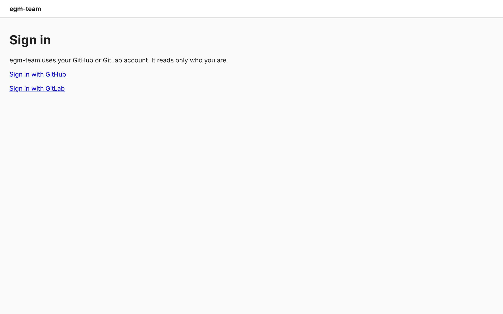
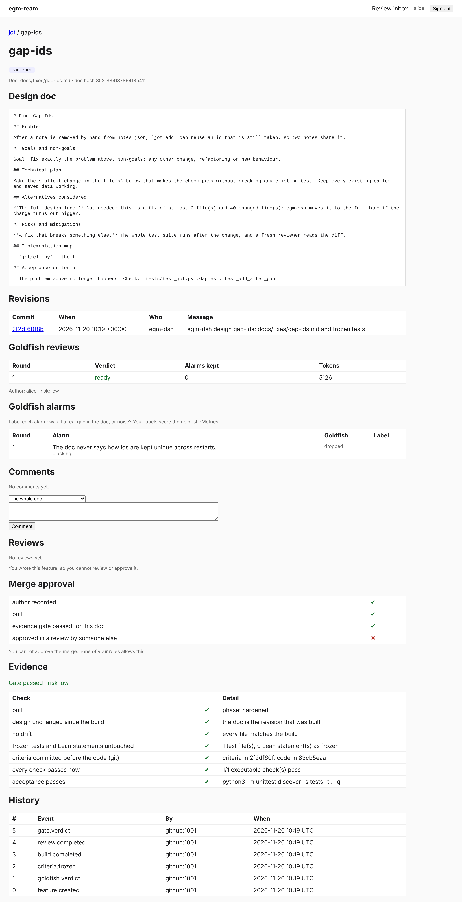
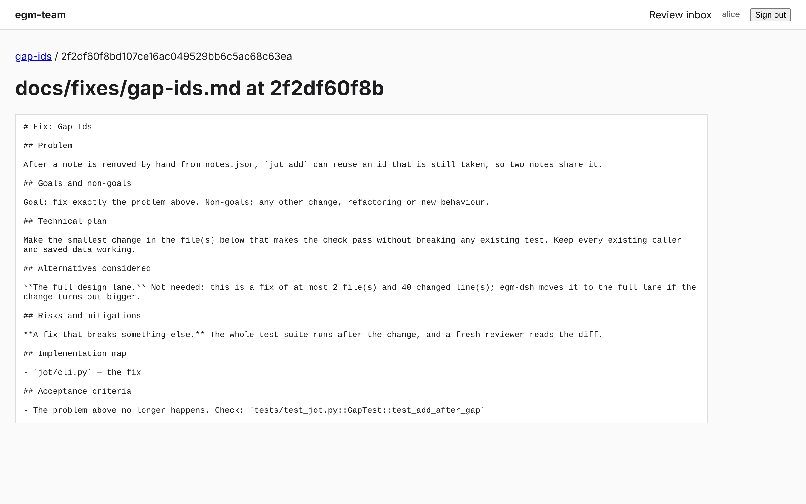
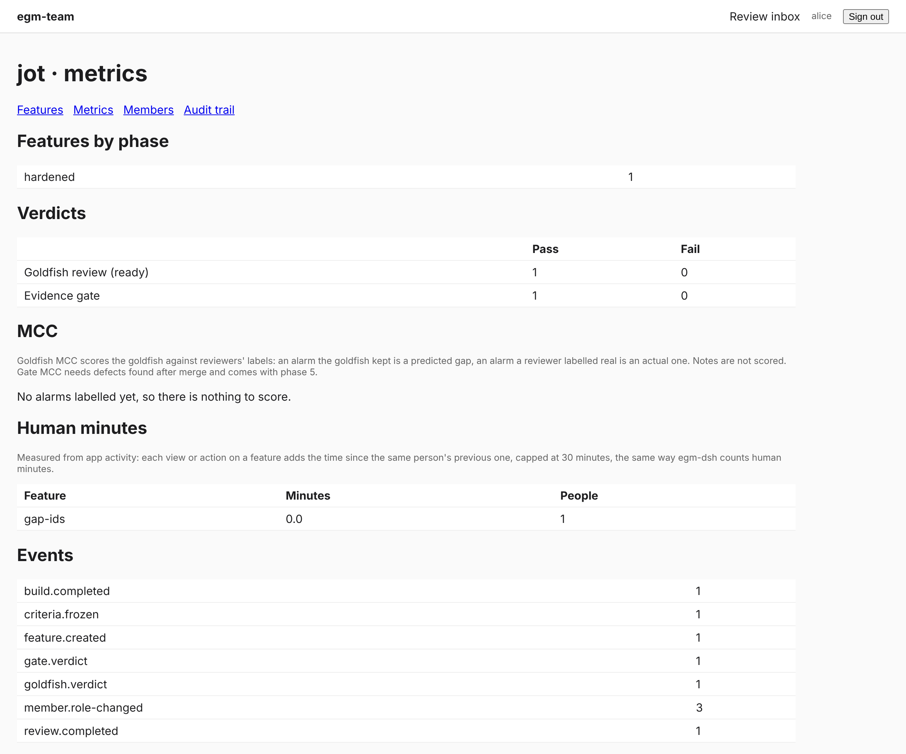
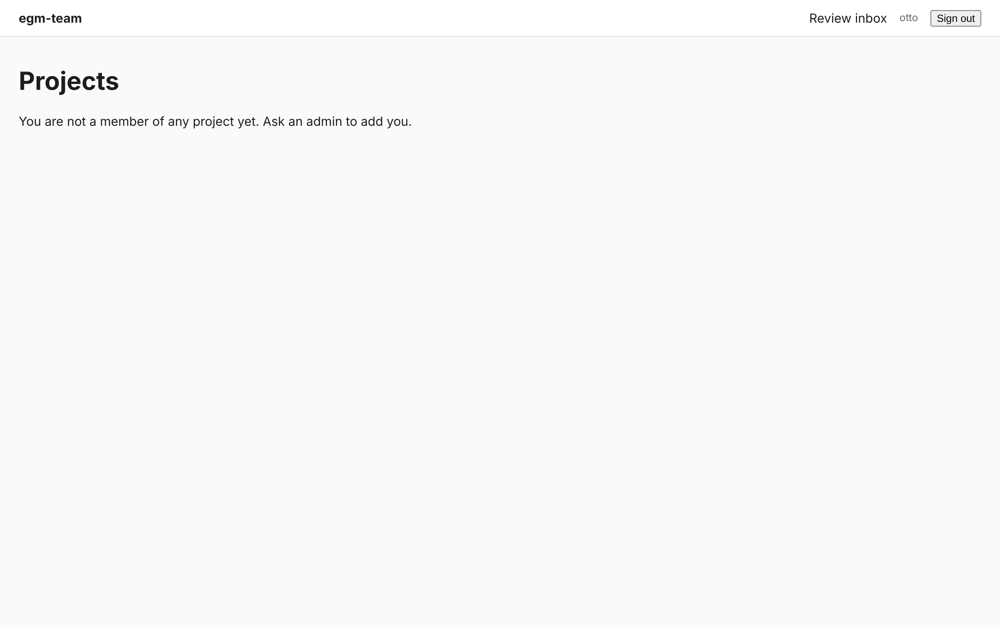
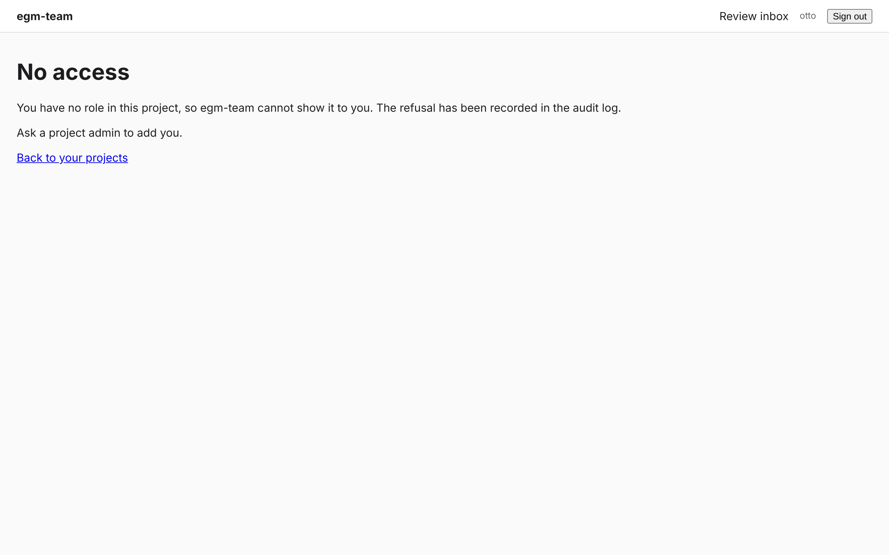
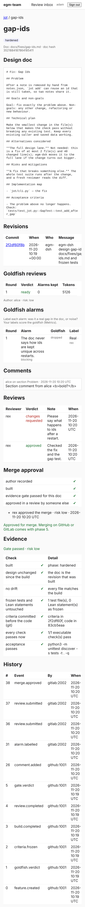
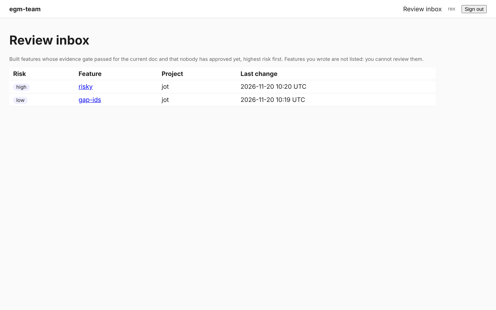
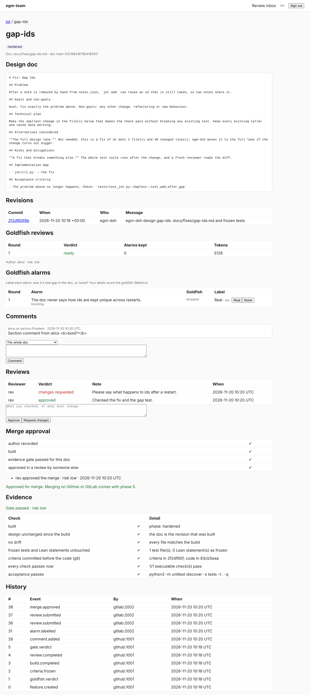
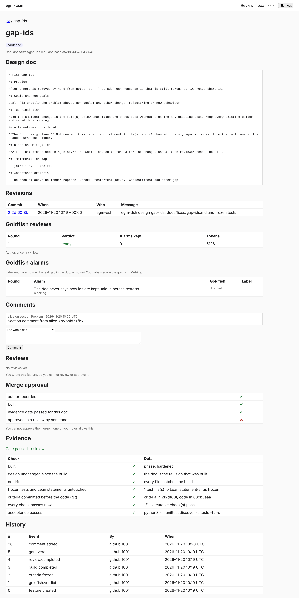

# egm-dsh and egm-team: user guide

This guide is task-first. Find your role, follow the steps. The [README](../README.md) explains how everything works and why; this guide says what to type and what to expect.

| You are | You use | Start at |
|---|---|---|
| A developer designing and building features | the `egm-dsh` command line | [Part 1](#part-1-developers-the-egm-dsh-command-line) |
| A reviewer, approver or teammate following the work | the `egm-team` web app | [Part 2](#part-2-the-team-web-app) |
| The person who runs egm-team for the team | `egm-team`, Postgres, Vesdb | [Part 3](#part-3-running-egm-team) |
| An auditor checking the record | `egm-audit`, `vesdb-verify` | [Part 4](#part-4-auditors-checking-the-record) |

What exists today: the command line (complete), the audit path into Vesdb, and the web app's read-only view (sign-in, projects, features, docs, reviews, evidence, metrics, members, audit trail). Comments, approvals and running egm-dsh from the browser are planned (phases 3 to 5 of the [implementation plan](https://claude.ai/artifact/J4NTLcJfrnrnbUGuH6ERpW)) and are marked *not yet* below.

## Contents

- [Install](#install)
- [Part 1: developers, the egm-dsh command line](#part-1-developers-the-egm-dsh-command-line)
- [Part 2: the team web app](#part-2-the-team-web-app)
- [Part 3: running egm-team](#part-3-running-egm-team)
- [Part 4: auditors, checking the record](#part-4-auditors-checking-the-record)
- [Reference](#reference)
- [Troubleshooting](#troubleshooting)

## Install

**egm-dsh** (the command line) needs Rust 1.97 or newer, git, and for real runs [DeepSeek Harness](https://github.com/deepseek-ai/deepseek-harness) (`dsh`, a Node package) and a `DEEPSEEK_API_KEY`. On Linux, install `bubblewrap` so model-written tests run in a sandbox.

```sh
git clone https://github.com/dhaneshkk/test1_egm && cd test1_egm
cargo install --path .                 # egm-dsh
cargo install --path crates/egm-audit  # egm-audit: events into Vesdb, receipts, bundles
```

**egm-team** (the web app) needs Rust 1.99 or newer (Topcoat's minimum), PostgreSQL 14 or newer, and a running [Vesdb](https://github.com/dhaneshkk/test1_vesdb).

```sh
cargo install --path crates/egm-web    # installs the egm-team binary
```

Everything at once, as CI does: `cargo build --workspace --release`. The single-cell Colab notebook builds the workspace, checks every Lean proof and runs every test suite.

## Part 1: developers, the egm-dsh command line

### 1. Try it offline first

```sh
egm-dsh demo
```

This creates `./egm-dsh-demo`, a tiny note-taking app, and adds a feature with a scripted model: the first goldfish review fails on a real gap in the design, you answer, the doc is redrafted, a fresh goldfish passes, and only then is code built. It takes seconds and costs nothing.

### 2. Set up your project

```sh
cd my-project
export DEEPSEEK_API_KEY=sk-...
egm-dsh init --agent dsh --preset balanced --acceptance cargo test   # or pytest, npm test, ...
egm-dsh doctor                                                       # sandbox, git, tools, key present
```

`init` creates `.egm-dsh/`. Commit it, except what its own `.gitignore` excludes (sessions, the lock). Presets choose a model and effort for each role: `economy` is cheapest, `balanced` is the default, `quality` uses the strongest model everywhere. Change one later with `egm-dsh preset economy`, or one role with `egm-dsh set-role`.

### 3. Design a feature with the elephant

Each feature gets a short name (a *slug*, such as `rate-limit`) and one design doc under `docs/designs/`.

```sh
egm-dsh elephant rate-limit --idea "Limit each API key to 100 requests a minute"
egm-dsh elephant rate-limit --say "Keys are per customer; bursts up to 20 are fine"
egm-dsh draft rate-limit
egm-dsh show rate-limit          # read the doc
```

The elephant reads your repository but cannot change it. Keep talking with `--say` until the doc says what you mean.

Already have a design doc? Put it under the gate instead: `egm-dsh adopt rate-limit --doc docs/designs/rate-limit.md`.

### 4. Let the goldfish test the doc

```sh
egm-dsh goldfish rate-limit
```

Fresh reviewers with no memory read only the doc and the files it links. They explain it back, criticize it, check it is the simplest design, and say whether they could build it. The result is READY or NOT READY.

When it is NOT READY:

```sh
egm-dsh escalate rate-limit      # the elephant answers what the repository settles; the rest become decisions
egm-dsh decide rate-limit        # list the open decisions
egm-dsh decide rate-limit 2 B    # pick option B for decision 2 (or: --other "your answer")
egm-dsh redraft rate-limit       # the decisions go into the doc
egm-dsh goldfish rate-limit      # a fresh goldfish reads the new revision
```

`egm-dsh loop rate-limit` runs those rounds for you and stops whenever it needs you. It never builds.

### 5. Freeze the acceptance tests (optional, recommended)

```sh
egm-dsh set-spec --tests-first on
egm-dsh tests rate-limit         # tests are written first; each must fail now; a goldfish checks each one
egm-dsh check rate-limit         # run the executable spec at any time
```

Frozen tests cannot be edited by the build, and the build must turn them green.

### 6. Build, review, keep docs and code in step

```sh
egm-dsh build rate-limit         # refused unless a goldfish passed this exact revision of the doc
egm-dsh review rate-limit        # a fresh, deliberately hostile review of the code
egm-dsh drift                    # exit 2 if built code changed without a design change
egm-dsh status                   # the phase of every feature
```

A feature moves through four phases:

| Phase | Means | Moves on when |
|---|---|---|
| `designing` | the doc is being shaped | a goldfish passes the current revision |
| `ready` | a goldfish passed this exact doc | the build succeeds and its checks pass |
| `built` | code written from an approved doc, checks green | the hostile review finds nothing blocking or major |
| `hardened` | reviewed | — |

Editing the doc at any point sends the feature back to `designing`. This rule is proved in Lean (`proofs/EgmGate.lean`).

### 7. Tiny fixes

For a one-line bug with a test that shows it:

```sh
egm-dsh fix gap-ids "Removed notes let add reuse an id" --files jot/cli.py --check tests/test_jot.py::GapTest::test_add_after_gap
```

The fix lane writes a short doc, checks the test fails, builds, checks it passes and reviews the diff. If the change grows beyond the fix limits it is reverted and moved to the full lane.

### 8. Evidence for the pull request

```sh
egm-dsh gate rate-limit                       # every evidence check; exit 1 on any failure (CI-friendly, no model)
egm-dsh evidence rate-limit --out PR.md       # the pull request description: gate, criteria, uncovered lines, seeded bugs, risk
egm-dsh risk rate-limit                       # risk tier and the suggested reviewer
egm-dsh log-time rate-limit 15 --what "read the pull request"
egm-dsh ci-template > .github/workflows/egm-gate.yml
```

### 9. Watch the cost

```sh
egm-dsh estimate rate-limit      # sessions and tokens the next goldfish round would use
egm-dsh usage                    # tokens and cost per role and model so far
egm-dsh set-ceiling 2000000      # refuse a round whose estimate would cross this many tokens
```

### 10. Send your work to the team app

Until the web app runs egm-dsh itself (*not yet*, phase 4), record events while you work and push them to the audit log:

```sh
egm-dsh --events events.jsonl goldfish rate-limit     # --events works with every command
egm-dsh --events events.jsonl build rate-limit
VESDB_URL=https://vesdb.example VESDB_TOKEN=... \
  egm-audit push events.jsonl --project my-project --job "$(git rev-parse --short HEAD)"
```

`--events` changes nothing on screen. `push` is safe to repeat with the same `--job`: events already written are not written again. Push your commits too; the web app reads docs, reviews and evidence from the team's checkout.

## Part 2: the team web app

### Sign in

Open the address your admin gave you and choose **Sign in with GitHub** or **Sign in with GitLab**. egm-team asks the provider only who you are; it never sees your password or your repositories. If you see "You are not a member of any project yet", ask an admin to add you (Part 3, step 5).

### Find your way

| Page | What you see |
|---|---|
| **Projects** (home) | The projects you belong to, with their feature count |
| **Features** (`/p/<project>`) | The board: one column per phase, newest change first. A red line on a card means the feature's history in the audit log contains a step the gate refuses; tell your admin |
| **Feature** (click a card) | The design doc as it is in the checkout; its git revisions (click one to read the doc as it was then); every goldfish review round with its verdict and how many alarms it kept; the evidence gate's checks, risk tier and seeded-bug score; the feature's audit history |
| **Review inbox** (header link) | Features waiting for your review in every project where you review: built, the evidence gate passed for the current doc, not yet approved, not written by you. Highest risk first |
| **Metrics** | Features by phase, goldfish and evidence-gate verdict counts; the goldfish MCC from reviewers' labels; human minutes per feature, measured from activity in the app |
| **Members** | Who holds which roles in the project |
| **Audit trail** | Every recorded event of the project, newest first. Each one is in Vesdb's tamper-evident log and can be verified offline |

### Work together on a feature

Everything below is on the feature page, under the goldfish reviews. Each action is written to the audit log first; if Vesdb does not accept it, nothing happens.

- **Comment.** Pick what the comment is about (the whole doc, one `##` section, or one alarm) and write it. Developers, reviewers and approvers can comment, the author included. The author is mailed when someone else comments.
- **Label alarms** (reviewers and approvers). For each goldfish alarm, say whether it was a **Real** gap in the doc or **Noise**. Click again to change your mind; the latest label counts. Notes are not listed: they never count against a doc, so there is nothing to score. Your labels score the goldfish on the Metrics page: an alarm the goldfish kept is its prediction of a real gap, your label is the truth. Below 29 labels in either class the MCC carries a warning; treat it as a sketch until then.
- **Review** (reviewers and approvers, once the feature is built). **Approve**, or **Request changes** with a note saying what must change. A review is for the doc as it is now; after the doc changes, earlier reviews are shown as "an earlier revision" and no longer count.
- **Approve the merge.** The panel lists the four things a merge approval needs and which are missing: the author is recorded, the feature is built, the evidence gate passed for this doc, and someone other than the author approved it in a review. A low- or medium-risk feature can then be approved by a reviewer; a high-risk one, or one whose risk was never assessed, only by an approver. The author never can, whatever roles they hold. Merging on GitHub or GitLab itself comes with phase 5.

**Mail.** When mail is configured (Part 3), egm-team mails reviewers and approvers when a feature's evidence gate passes, and mails the author when someone else comments, reviews, or approves the merge. Nobody is mailed about their own action. The address is the one your GitHub or GitLab account shows publicly; with none, you get no mail.

**Minutes.** Each time you open a feature or act on it, egm-team adds the time since your previous visit or action, at most 30 minutes (a longer gap is time away), the same way egm-dsh counts human minutes. Nothing else about your activity is kept.

### Screens

Captured by the browser test (`tests/e2e/run_web_e2e.py`) against real egm-dsh output, Vesdb and Postgres, with a fake GitHub and GitLab for sign-in.

| | |
|---|---|
|  **Sign in** |  **Projects** |
|  **Feature board** |  **Feature: doc, revisions, reviews, evidence, history** |
|  **The doc at a past commit** |  **Metrics** |
|  **Members** |  **Audit trail** |
|  **Signed in, no role yet** |  **403: no role in this project** |
|  **Board on a phone** |  **Feature page on a phone** |
|  **Review inbox, highest risk first** |  **Labelling alarms, comments** |
|  **Reviews and the merge panel** |  **Goldfish MCC from labels, human minutes** |
|  **The author's view: no review, no approval** | |

### What you can do with each role

| Role | Can (today) | Will be able to |
|---|---|---|
| developer | read, comment | start features and run egm-dsh jobs (phase 4) |
| reviewer | read, comment, label alarms, review, approve low- and medium-risk merges | |
| approver | everything a reviewer can, and approve high-risk merges | export evidence |
| admin | read | change members, roles and project settings in the app, export evidence |
| auditor | read | export evidence |

Nobody can review or approve a feature they wrote, whatever roles they hold.

### When something says no

- **403 Forbidden**: you have no role in that project, or your roles do not allow that action (reviewing your own feature, approving a high-risk merge without the approver role). The refusal is recorded in the audit log with your id and the action.
- **"cannot approve yet: …"**: the merge panel's reason, such as no approving review by someone else yet, or a gate that passed for an older doc. The attempt is recorded too.
- **Sign-in failed**: start again from the sign-in page in the same browser tab. Sign-in links expire after ten minutes and work only in the browser that started them.
- **The page is out of date**: the app reads new events every second or so. A doc change shows once it is pushed to the team's checkout.

## Part 3: running egm-team

### What runs where

| Part | Role |
|---|---|
| `egm-team serve` | The web app. Stateless apart from Postgres, so you can run more than one |
| PostgreSQL | Views of the audit log, plus sessions. Disposable: `egm-team rebuild` recreates every view from Vesdb |
| Vesdb | The record. Run it highly available as its README describes: two servers on a shared bucket (`--role auto`), at least one witness under a separate account |
| The project checkout | A git clone egm-team reads docs, reviews and evidence from, read-only. Keep it current (for example `git pull` on a timer) |
| GitHub and/or GitLab OAuth apps | Sign-in |

Put egm-team behind TLS (a load balancer or reverse proxy) and set `public_url` to the `https://` address; session and sign-in cookies are then marked Secure.

### 1. Register the OAuth apps

- **GitHub**: Settings → Developer settings → OAuth Apps → New. Homepage: your `public_url`. Authorization callback URL: `<public_url>/auth/github/callback`.
- **GitLab**: User or group Settings → Applications. Redirect URI: `<public_url>/auth/gitlab/callback`. Scope: `read_user` only. Confidential: yes.

Keep each client secret for step 3.

### 2. Prepare Postgres and Vesdb

```sh
createdb egm                       # egm-team creates its tables on start
```

Create a Vesdb token with the read and write scopes (add audit if the same token will fetch receipts and bundles).

### 3. Write the configuration

`egm-team.toml`:

```toml
listen       = "127.0.0.1:8080"
public_url   = "https://egm-team.example"
database_url = "host=/run/postgresql dbname=egm"
vesdb_url    = "http://vesdb-a:3000,http://vesdb-b:3000"   # the load balancer, or both servers
admins       = ["github:1234"]                              # admin role in every project
refresh_ms   = 1000                                         # how often to read new events

[[project]]
name     = "my-project"            # letters, digits, - and _
checkout = "/srv/egm/my-project"
host     = "github"                # or "gitlab"

[github]
client_id = "Iv1.abc"
# base_url and api_url only for GitHub Enterprise

[gitlab]
client_id = "abc"
base_url  = "https://gitlab.com"   # or your own GitLab

[mail]                             # optional: notifications
host     = "smtp.example"
port     = 587
tls      = "starttls"              # or "tls" (port 465), or "none" (a local relay only)
from     = "egm-team <egm-team@example>"
username = "egm-team"              # optional; the password comes from EGM_SMTP_PASSWORD
```

Secrets come from the environment only:

| Variable | Holds |
|---|---|
| `EGM_VESDB_TOKEN` | The Vesdb token |
| `EGM_GITHUB_CLIENT_SECRET` | Needed when `[github]` is configured |
| `EGM_GITLAB_CLIENT_SECRET` | Needed when `[gitlab]` is configured |
| `EGM_SMTP_PASSWORD` | Needed when `[mail]` has a `username` |

A user id is the provider and the provider's numeric id, such as `github:1234` or `gitlab:5678`; it stays the same if they rename their account. Find a GitHub id at `https://api.github.com/users/<login>`, a GitLab id on the user's profile page.

### 4. Start

```sh
egm-team --config egm-team.toml serve
curl -s https://egm-team.example/health      # ok
```

### 5. Give people roles

```sh
egm-team --config egm-team.toml grant --project my-project --user github:5678 --roles developer --by github:1234
egm-team --config egm-team.toml grant --project my-project --user gitlab:777 --roles reviewer,approver --by github:1234
egm-team --config egm-team.toml grant --project my-project --user gitlab:777 --roles ""   # remove
```

Each grant is written to Vesdb as `member.role-changed`, so the history of who had access, and who gave it, is part of the record. The `worker` role cannot be given to a person.

A field-test team of four could be two developers, one reviewer and one approver. With a single reviewer, the approver also reviews when the reviewer is away; the policy allows it because the approver is never the author.

### 6. Day to day

| Task | How |
|---|---|
| Rebuild the views (after a restore, or if in doubt) | `egm-team --config egm-team.toml rebuild` |
| Back up | Vesdb is the record; follow its backup guidance. Postgres needs no backup: every view is rebuilt from Vesdb, and losing it only signs people out and resets the activity minutes. The mail outbox survives `rebuild`, so nobody is mailed twice |
| See failed mail | `SELECT to_addr, subject, error FROM outbox WHERE error IS NOT NULL` in Postgres; egm-team's log names each failure |
| See refusals and sign-ins | The project's Audit trail page, or read `/egm/_system` and `/egm/<project>` from Vesdb |
| Upgrade | Topcoat is pinned to 0.12.1 and lives only in `crates/egm-web`; upgrade it there and run the browser test (`tests/e2e/run_web_e2e.py`) |

If Vesdb is unreachable, nobody can sign in (a sign-in is recorded before the session starts) and refusals are reported in egm-team's log instead of the audit log. Pages people are already signed in to keep working from the views.

## Part 4: auditors, checking the record

### What is recorded

Every change to a feature, every sign-in and failed sign-in, every role change and every refusal by the policy, as events under `/egm/<project>/<feature>`, `/egm/<project>` and `/egm/_system`. Events carry hashes, counts, verdicts and user ids; never source code or document text. The full list is in the [reference](#event-types).

### Check one event, or a whole feature

```sh
export VESDB_URL=https://vesdb.example VESDB_TOKEN=...   # a token with the audit scope
egm-audit receipt 42                     # the signed receipt and inclusion proof for event 42
egm-audit bundle 40 41 42 > bundle.json  # an offline evidence bundle
vesdb-verify bundle bundle.json --log-key log.pub --witness-key witness.pub
```

`vesdb-verify` needs only the public keys; it does not trust any server. To check the whole log in its bucket: `vesdb-verify bucket s3://bucket/prefix --log-key log.pub`.

### Check that the app shows the record

```sh
egm-audit replay-vesdb --project my-project    # each feature's phase, rebuilt from the log alone
```

The phase printed for each feature must match the board. That it always does is proved in Lean (`EgmReplay.replay_emitted`), and the audit export holds exactly the events the app replays (`VesdbLink.export_exact`).

### The guarantees behind the controls

| Control | Where it is proved or tested |
|---|---|
| Nobody reviews or approves their own work; only an approver approves a high-risk change; the worker never approves | `proofs/EgmPolicy.lean` |
| A merge approval needs a built feature, a gate passed for the current doc and an approving review by someone else | `EgmPolicy.merge_never_self`, `merge_needs_gate`, `merge_needs_other_review`, `merge_high_needs_approver`; `policy.rs` checks every combination; `run_web_e2e.py` (the author's attempts and the reviewer's high-risk approval are refused and recorded) |
| The goldfish MCC counts every reviewer label exactly once, the latest per alarm | `proofs/EgmLabels.lean`: `confusion_total`, `perfect_agreement`, `relabel_moves_one`; `run_web_e2e.py` (MCC on the page equals the MCC of the clicks, before and after a rebuild) |
| A person with no role in a project can read nothing in it | `EgmPolicy.read_iff_member`; `run_web_e2e.py` (outsider gets 403 on every page, each refusal recorded) |
| Every page checks the policy first | `crates/egm-web/tests/policy_lint.rs` fails the build otherwise |
| No build without a goldfish pass of the current doc | `proofs/EgmGate.lean` |
| The record cannot be changed unnoticed | Vesdb's Merkle log, witness-signed checkpoints and offline bundles (proved in Vesdb's repository); `run_audit_e2e.py` (one changed byte fails verification) |

## Reference

### egm-dsh commands by task

| Task | Commands |
|---|---|
| Set up | `init`, `doctor`, `preset`, `roles`, `set-role`, `set-safety`, `set-spec`, `set-verification` |
| Design | `elephant`, `draft`, `adopt`, `show`, `set-scope`, `set-draft-words`, `set-diagrams`, `diagrams` |
| Review the design | `goldfish`, `escalate`, `decide`, `redraft`, `loop`, `set-review`, `set-reviewers` |
| Steps and size | `after`, `set-limits`, `set-fix-limits` |
| Tests first | `tests`, `check` |
| Build | `build`, `review`, `fix`, `drift`, `status` |
| Evidence | `gate`, `mutate`, `evidence`, `risk`, `log-time`, `ci-template`, `set-gate` |
| Cost | `estimate`, `usage`, `budget`, `set-budget`, `set-ceiling` |
| Learning | `label`, `metrics`, `set-triage` |

`egm-dsh <command> --help` gives every option. The README's command table explains each one.

### Roles and actions

`crates/egm-core/src/policy.rs`, mirrored by `proofs/EgmPolicy.lean`:

| Action | developer | reviewer | approver | admin | auditor | worker |
|---|---|---|---|---|---|---|
| read | ✓ | ✓ | ✓ | ✓ | ✓ | ✓ |
| create feature, run job | ✓ | | | | | |
| comment | ✓ | ✓ | ✓ | | | |
| label alarm, submit review, approve merge | | ✓ | ✓ | | | |
| record job | | | | | | ✓ |
| change roles, change settings | | | | ✓ | | |
| export | | | ✓ | ✓ | ✓ | |

Two rules apply on top: an author can never submit a review of, or approve, their own feature; a high-risk merge needs the approver role.

### Event types

Stored in Vesdb as `io.egm.<type>`.

| Type | Written by | Subject | Data |
|---|---|---|---|
| `feature.created` | egm-dsh | feature | doc path, doc hash, dependencies |
| `doc.revised` | egm-dsh | feature | doc hash, phase |
| `goldfish.verdict` | egm-dsh | feature | ready or not, doc hash, phase |
| `decision.recorded` | egm-dsh | feature | decision number, chosen option, doc hash |
| `criteria.frozen` | egm-dsh | feature | doc hash, per criterion: check, test file hash, red |
| `build.completed` | egm-dsh | feature | doc hash, phase |
| `review.completed` | egm-dsh | feature | clean or not, doc hash, phase |
| `gate.verdict` | egm-dsh | feature | pass, checks, seeded bugs caught, risk tier |
| `member.role-changed` | `egm-team grant` | project | user, roles (empty: removed) |
| `auth.signed-in` | egm-team | `_system` | user id, login, name, provider |
| `auth.sign-in-failed` | egm-team | `_system` | provider, reason |
| `policy.refused` | egm-team | project | action, reason; the actor is the refused user |
| `comment.added` | egm-team | feature | target (doc, section or alarm), text, doc hash |
| `alarm.labelled` | egm-team | feature | round, alarm, valid or noise, whether the goldfish kept it, doc hash |
| `review.submitted` | egm-team | feature | approve or changes, note, doc hash |
| `merge.approved` | egm-team | feature | doc hash, risk tier |

Comments and review notes are the one place people's words enter the log, because they are the review record. Planned with later phases: `project.settings-changed`, `export.created`.

### Files egm-dsh keeps

| Path | Holds |
|---|---|
| `.egm-dsh/config.json` | Agent, presets, roles, gate and review settings |
| `.egm-dsh/features/<slug>.json` | Each feature's gate state, phase, frozen spec |
| `.egm-dsh/reviews/<slug>-<n>.json` | Each goldfish review round |
| `.egm-dsh/evidence/<slug>.json` | The last evidence gate record |
| `.egm-dsh/events.jsonl`, `usage.jsonl`, `ledger.jsonl` | Command timings, token usage, decisions |
| `docs/designs/<slug>.md` | The design docs |

## Troubleshooting

| Message or symptom | What it means | What to do |
|---|---|---|
| `build` is refused: no goldfish passed | The doc changed since the last pass, or never passed | Run `goldfish` again on the current doc |
| `redraft` is refused: a decision is open | An escalated question still needs your choice | `decide <f>` to list them, then choose |
| `goldfish` is refused: over the ceiling | The round's estimate would cross `set-ceiling` | Raise the ceiling, or `preset economy` |
| `drift` exits 2 | Built files changed without a design change | Update the doc and go through the gate, or revert the change |
| `gate` fails "seeded bugs caught" | The tests miss bugs planted in the changed lines | Strengthen the tests; `mutate <f>` lists the bugs that survived |
| `egm-audit push`: "set VESDB_URL" | The environment is missing | Export `VESDB_URL` and `VESDB_TOKEN` |
| egm-team won't start: "set EGM_..." | A secret is missing from the environment | Export the variable it names |
| A feature card shows a red line | The audit log holds a gate step the gate refuses: written by something other than egm-dsh | Check the feature's audit history; report it |
| A built feature is not in the review inbox | The gate has not passed for the current doc, the merge is already approved, or you wrote it | Open the feature: the merge panel says which |
| No mail arrives | `[mail]` is not configured, your provider account shows no public email, or the SMTP server refused it | Ask the admin to check the outbox (Part 3, step 6) |
| Everyone is signed out after a restart | Sessions live in Postgres; a new database means new sessions | Sign in again; nothing in the record is lost |
